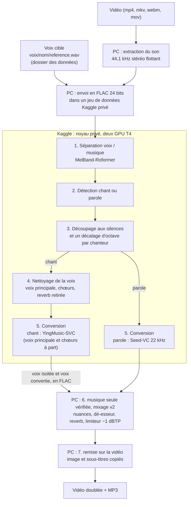

# Voix-là

Voix-là : votre vidéo, avec une autre voix. Et voilà.

> **Version 0.8.0** : paquet Debian `.deb` joint à chaque [release](https://github.com/mawena/Voix-la/releases). Voir le
> [journal des modifications](CHANGELOG.md).

`doubler` prend une vidéo (chanson d'une chanteuse ou d'un chanteur, duo, rap, ou vidéo parlée) et rend la même vidéo,
avec son audio, où la voix est remplacée par une voix clonée. La mélodie, le phrasé et l'interprétation restent ceux de
la vidéo. Seul le timbre change : c'est celui de la voix cible.

```sh
doubler --config kaggle.compte <votre-compte>                    # une fois : votre compte Kaggle
doubler --ajouter-voix marie ~/Téléchargements/vocal-marie.ogg   # une fois : enregistrer la voix cible
doubler "Clip.mp4" --voix marie                                  # doubler une vidéo entière
doubler "Clip.mp4" --voix marie --debut 60 --duree 40            # ou un essai de 40 s
```

Le calcul lourd tourne sur un GPU gratuit de Kaggle (T4), piloté depuis le PC par l'API Kaggle. Le PC ne fait que
l'extraction du son, le mixage et la remise sur la vidéo.

## Sommaire

- [Fonctionnement](#fonctionnement)
- [Prérequis](#prérequis)
- [Installation](#installation)
- [Configuration](#configuration)
- [Utilisation](#utilisation)
- [Options](#options)
- [Sorties](#sorties)
- [Ajouter une voix](#ajouter-une-voix)
- [Interface graphique (en cours)](#interface-graphique-en-cours)
- [Modes : chant, parole, duo, rap](#modes--chant-parole-duo-rap)
- [Temps de traitement](#temps-de-traitement)
- [Limites connues](#limites-connues)
- [Usage responsable](#usage-responsable)
- [Feuille de route](#feuille-de-route)
- [Développement](#développement)
- [Crédits](#crédits)
- [Licence](#licence)

## Fonctionnement



- **Extraction (PC).** Le son de chaque vidéo est extrait en 44,1 kHz stéréo flottant (les sources dépassent souvent
  0 dBFS).
- **Envoi (PC vers Kaggle).** Le son part en FLAC 24 bits, une compression sans perte, environ deux fois plus léger
  que le WAV flottant. Il part avec la référence de la voix cible. Le FLAC est en entiers et écrêterait au-dessus de
  0 dBFS : la crête est donc ramenée à −1 dBFS par un gain connu, que le noyau retire à la lecture. La voix isolée
  revient de la même façon, et `doubler` retire le gain à son tour.
- **Séparation (Kaggle).** MelBand-Roformer (via audio-separator) isole la voix. Comme les Roformer du nettoyage, il
  tourne en demi-précision (autocast fp16, les cœurs fp16 des T4) : 2,4 fois plus vite qu'en fp32, pour la même voix
  à 70 dB près.
- **Mode (Kaggle).** `chant` s'il y a une musique sous la voix et que la voix chante, ou rappe sur un fond tonal ;
  sinon `parole`. Voir [Modes](#modes--chant-parole-duo-rap).
- **Hauteur (Kaggle).** La voix est découpée aux silences en passages de quelques secondes. En chant, chaque
  chanteur reçoit un seul décalage, −12, 0 ou +12 demi-tons, pour toute la chanson : la musique garde sa tonalité.
  Le mode et l'octave sont décidés sur la voix isolée complète, avant le nettoyage.
- **Nettoyage (Kaggle, chant seulement).** La voix isolée est séparée en voix principale et chœurs, puis la reverb
  d'origine est retirée des deux. Voir [Nettoyage de la voix](#nettoyage-de-la-voix).
- **Conversion (Kaggle).** Sans entraînement, à partir de la référence de la voix :
  - chant : YingMusic-SVC (défaut) ou Seed-VC 44,1 kHz, guidés par la hauteur. La voix principale et les chœurs sont
    convertis à part, avec les mêmes décalages, puis chacun est ramené au niveau de sa source et les deux sont
    additionnés ;
  - parole : Seed-VC 22 kHz, sur la voix isolée complète.

  Les passages sont réassemblés à l'échantillon près.
- **Deux cartes (Kaggle).** La machine demandée (`NvidiaTeslaT4`, « GPU T4 x2 ») a deux cartes T4. Le nettoyage
  (karaoké sur une carte, puis dereverb de la voix principale et des chœurs chacune sur la sienne), la conversion
  YingMusic-SVC (morceaux pris par la première carte libre) et la séparation d'un lot s'y partagent le travail. Les
  paroles, prêtes dès la fin du nettoyage, passent sur la carte 1 pendant que la carte 0 commence la conversion ; la
  carte 1 rejoint ensuite la conversion. Les modèles se chargent l'un après l'autre, et Whisper ne partage jamais une
  carte avec YingMusic-SVC. Chaque morceau garde sa graine et les pistes sont assemblées dans le même ordre : le son et
  les paroles sont ceux d'une carte seule, au bit près, sauf le texte d'un morceau où Whisper boucle et repasse en
  températures échantillonnées (ce qu'il en reste après les garde-fous peut varier d'une carte à l'autre). `--gpu 1` revient à une carte (paroles après la conversion).
  Avec une machine à une seule carte, ou une carte arrêtée en route, le noyau se replie de lui-même sur une carte,
  paroles comprises. Sans morceau pour YingMusic-SVC (Seed-VC, parole), les paroles passent après la conversion sur la
  carte 1, que le noyau n'occupe pas (il garde Seed-VC chargé sur la carte 0).
- **Musique seule (PC).** Le reste (musique, bruits) vaut exactement l'original moins la voix isolée. Il est
  recalculé à chaque mixage, puis vérifié par trois garde-fous :
  - reconstruction : musique seule + voix redonnent l'original ;
  - niveau : la musique seule n'est pas plus forte que l'original ;
  - corrélation : la musique seule n'est presque pas corrélée à la voix (il n'y reste pas de voix).

  Si un garde-fou échoue, le mixage s'arrête avec un message.
- **Mixage (PC).** Mixage v2 par défaut. La voix convertie est filtrée (passe-haut) et compressée. Un dé-esseur
  adoucit ses « s ». Elle suit ensuite les nuances de la voix d'origine (±6 dB, lissé). Elle est calée sur le niveau
  moyen de la voix d'origine, avec une reverb synthétique en chant. Un limiteur tient la crête vraie à −1 dBTP. En
  chant, la voix convertie est sèche : cette reverb est la seule (ni la reverb ni les chœurs d'origine ne restent dans
  la musique seule).
- **Remise sur la vidéo (PC).** L'image et les sous-titres sont copiés sans réencodage ; seul le son est réencodé.

Toutes les vidéos d'une même commande partent dans **une seule session Kaggle** : l'installation n'est payée qu'une
fois.

## Prérequis

- **Linux**, avec `ffmpeg` et `ffprobe`.
- **Python 3** en `/usr/bin/python3`, avec **numpy** (utilisé par `--ajouter-voix` et par le mixage).
- **Facultatif, pour l'auto-tune : x42-autotune** (`sudo apt install x42-plugins`, recommandé par le paquet Debian).
  `doubler` le cherche dans `LV2_PATH`, puis dans `~/.lv2`, `/usr/local/lib/lv2`, `/usr/lib/lv2` et les dossiers
  multiarch. Sans lui, un auto-tune demandé est signalé et seule la version normale est faite.

  Le [paquet Debian](#paquet-debian) installe ces deux prérequis, et ceux de l'interface graphique.
- **Un compte Kaggle avec le GPU activé.** Kaggle ne donne le GPU et internet aux noyaux qu'après la vérification du
  numéro de téléphone du compte (page *Settings* de Kaggle). Sans elle, le noyau s'arrête sur « ACCÈS REFUSÉ ».
- **La commande Kaggle** dans un environnement Python dédié, à l'emplacement attendu par `doubler`. Elle n'est pas
  fournie par le paquet Debian (Ubuntu n'en a pas), et s'installe à part, sans `sudo` (sous Ubuntu, `python3 -m venv`
  demande le paquet `python3-venv`) :

  ```sh
  python3 -m venv ~/kaggle-venv
  ~/kaggle-venv/bin/pip install kaggle
  ```

  Pour une commande `kaggle` installée ailleurs, la variable d'environnement `VOIXLA_KAGGLE` donne son chemin, pour
  `doubler` comme pour l'interface :

  ```sh
  export VOIXLA_KAGGLE=~/.local/bin/kaggle   # par exemple, dans ~/.profile
  ```

- **Un jeton d'API Kaggle** dans `~/.kaggle/access_token`. Il se crée depuis la page *Settings* de Kaggle, section
  *API*. `doubler` refuse de lancer un doublage ou une reprise si ce fichier manque.

  ```sh
  mkdir -p ~/.kaggle
  # copier le jeton dans ~/.kaggle/access_token, puis :
  chmod 600 ~/.kaggle/access_token
  ```

  Le jeton donne accès à tout votre compte Kaggle. Ne le publiez jamais et ne le mettez jamais dans le dépôt
  (`.gitignore` exclut `access_token` et `kaggle.json`).

Rien d'autre n'est à installer sur le PC : PyTorch, audio-separator, Seed-VC, YingMusic-SVC et les poids des modèles
sont installés sur Kaggle. L'interface graphique a ses propres prérequis (voir
[Interface graphique](#interface-graphique-en-cours)).

## Installation

### Paquet Debian

Pour Ubuntu 24.04 ou plus récent (libadwaita 1.5 au moins). Le paquet `voix-la_<version>_all.deb` et ses sommes
`SHA256SUMS` sont joints à chaque version sur GitHub (*Releases*), ou se construisent depuis le dépôt (voir
[Construire le paquet](#construire-le-paquet)).

```sh
sha256sum -c SHA256SUMS
sudo apt install ./voix-la_0.2.0_all.deb
doubler --version
```

`apt` installe aussi les dépendances : Python 3 et numpy, ffmpeg, PyGObject, GTK 4, libadwaita, GStreamer et ses
greffons. Le paquet contient :

| Emplacement | Contenu |
|---|---|
| `/usr/bin/doubler` | la commande `doubler` |
| `/usr/bin/voix-la` | l'interface graphique, aussi dans le menu des applications (« Voix-là ») |
| `/usr/lib/voix-la/` | le code : `doubler.py`, le noyau `kaggle/doubler_kaggle.py`, l'interface `voixla/` |
| `/usr/share/man/man1/` | les pages de manuel `doubler(1)` et `voix-la(1)` |
| `/usr/share/doc/voix-la/` | ce README et le journal des modifications |

La commande `kaggle` et son jeton restent à installer à part (voir [Prérequis](#prérequis)). Les données ne sont
jamais dans le paquet : la configuration, les voix et les doublages restent chez l'utilisateur, et `sudo apt remove
voix-la` n'y touche pas.

### Depuis le dépôt (développement)

```sh
git clone https://github.com/mawena/Voix-la.git
cd Voix-la
mkdir -p ~/.local/bin
ln -s "$PWD/bin/doubler" ~/.local/bin/doubler    # la commande doubler, disponible partout
doubler --help
```

`~/.local/bin` doit être dans le `PATH`. Le lanceur `bin/doubler` suit le lien et exécute `doubler.py` du dépôt, qui
trouve `kaggle/` à côté de lui. Un lien direct vers `doubler.py` marche aussi. Si le paquet est aussi installé,
`~/.local/bin` passe en général avant `/usr/bin` dans le `PATH` : `doubler` est alors celui du dépôt.

Le code et les données sont séparés : le dépôt ne contient que le code. Les voix et les doublages vont dans le
dossier des données, `~/Music/Voix-là` par défaut (voir [Configuration](#configuration)). Mettre à jour le code ne
touche donc ni à vos voix ni à vos sorties.

Ensuite, une fois :

```sh
doubler --config kaggle.compte <votre-compte>   # obligatoire : votre nom d'utilisateur Kaggle
doubler --preparer-outils
```

`--preparer-outils` lance un noyau privé « outils ». Il garde sur Kaggle :

- les paquets pip ;
- Seed-VC et YingMusic-SVC, chacun à un commit figé ;
- les poids de tous les modèles : séparation et nettoyage (trois Roformer), Seed-VC, YingMusic-SVC, et leurs modèles
  auxiliaires.

Le noyau télécharge tout lui-même depuis GitHub et Hugging Face : rien ne part du PC à part son script. Les doublages
suivants le montent au lieu de tout retélécharger, et se replient sur internet s'il manque ou ne correspond plus. Ce
n'est pas obligatoire : sans lui, chaque session télécharge tout. Relancez-le après une mise à jour de `doubler` qui
ajoute un modèle.

`doubler` retient que les outils sont prêts dans `<sortie>/.kaggle/outils.json` et dans
`~/.local/state/voix-la/outils.json` (avec le nom du noyau d'outils). Les outils sont ceux du compte Kaggle : un autre
dossier de sortie (`--sortie`) ou un autre dossier des données les retrouve sans relancer `--preparer-outils`. Ceux
préparés avant cette version sont retrouvés dans `<données>/sorties/.kaggle/outils.json`. Sans outils, `doubler` le
dit (environ 4 min de plus par session).

## Configuration

### Fichier de configuration

`doubler` lit `~/.config/voix-la/config.json`. Le compte Kaggle y est écrit, jamais dans le code. Le jeton n'y va
pas : il reste dans `~/.kaggle/access_token`.

```sh
doubler --config                                # afficher la configuration et les valeurs utilisées
doubler --config --json                         # la même chose en JSON, pour un script
doubler --config kaggle.compte <votre-compte>   # écrire une clé
doubler --config donnees ~/Musique/Voix-là      # changer le dossier des données
doubler --config voix marie                     # choisir la voix par défaut
```

| Clé | Rôle | Défaut |
|---|---|---|
| `kaggle.compte` | votre nom d'utilisateur Kaggle | aucun : obligatoire |
| `kaggle.jeu` | jeu de données privé des entrées (son des vidéos, référence) | `doublage-voix-entrees` |
| `kaggle.noyau` | noyau GPU privé du doublage | `doublage-voix-gpu` |
| `kaggle.outils` | noyau privé des outils préparés (`--preparer-outils`) | `doublage-outils` |
| `kaggle.machine` | machine Kaggle demandée à l'envoi du noyau (`machine_shape`) ; si Kaggle la refuse, `doubler` réessaie sur `NvidiaTeslaT4` | `NvidiaTeslaT4` (GPU T4 x2) |
| `donnees` | dossier des données (`voix/`, `sorties/`) | `~/Music/Voix-là` |
| `moteur` | moteur de conversion du chant : `yingmusic` ou `seedvc` (`--moteur` l'emporte) | `yingmusic` |
| `voix` | voix cible par défaut, un dossier de `<données>/voix/` (`--voix` l'emporte) | la seule voix présente |
| `paroles` | paroles à chaque doublage : oui ou non (`--sans-paroles` l'emporte) | oui |
| `autotune` | intensité de l'auto-tune, de 0 (désactivé) à 100 : `doubler --config autotune 70` (`--autotune` et `--sans-autotune` l'emportent) | 0 |
| `pistes_audio` | pistes audio de la vidéo doublée : `toutes` (doublage, original, beat seul, voix convertie seule, voix d'origine seule) ou `doublage` (lui seul) (`--pistes-audio` l'emporte) | `toutes` |
| `gpu` | cartes GPU du noyau : `auto` (les deux T4 de la machine, une seule si elle n'en a qu'une), `1` (une carte, comme avant) ou `2` (`--gpu` l'emporte) | `auto` |

Le fichier ressemble à ceci :

```json
{
 "kaggle": {
  "compte": "<votre-compte>"
 }
}
```

- Les noms Kaggle prennent la forme `<compte>/<nom>`. Le jeu de données et les noyaux sont créés au premier
  lancement, en privé.
- Sans `kaggle.compte`, un doublage, `--reprendre` et `--preparer-outils` s'arrêtent sur « compte Kaggle non
  configuré », avec la commande à taper. `--config`, `--voix-liste`, `--ajouter-voix` et `--remix` n'en ont pas
  besoin.
- `--config CLE VALEUR` n'accepte que les clés du tableau. Il garde les autres clés du fichier et l'écrit d'un seul
  coup. `donnees` y est noté en chemin absolu ; `moteur` n'accepte que `yingmusic` ou `seedvc` ; `voix` n'accepte
  qu'un nom de voix valide (minuscules, chiffres, `-` ou `_`), et prévient si cette voix n'existe pas encore ; `gpu`
  n'accepte que `auto`, `1` ou `2` ; `kaggle.machine`, des lettres et des chiffres.
- `--config` seul affiche le fichier, puis les valeurs utilisées : dossier des données et d'où il vient, dossiers des
  voix et des sorties, voix par défaut et d'où elle vient, noms Kaggle complets, présence du jeton, commande
  `kaggle`, script du noyau et fichier des ancres de genre utilisés. Le jeton n'est jamais affiché, seulement
  « présent » ou « absent ». En JSON (`--json`), la voix par défaut est dans `voix_defaut` (`null` s'il n'y en a pas)
  et sa provenance dans `source_voix_defaut` ; la commande `kaggle` dans `commande_kaggle`, le script du noyau dans
  `script_noyau` et les ancres dans `ancres_genre` (`null` sans ancres) ; les cartes GPU dans `gpu` et la machine
  dans `kaggle.machine`.

### Dossier des données

Le dossier des données est choisi dans cet ordre :

1. l'option `--donnees DIR` ;
2. la variable d'environnement `VOIXLA_DONNEES` ;
3. la clé `donnees` de `config.json` ;
4. `~/Music/Voix-là`.

Il contient `voix/` (les voix) et `sorties/` (les doublages). Deux réglages gardent la priorité :
`DOUBLER_VOIX` range les voix ailleurs, et `--sortie DIR` les sorties.

### État

`doubler` garde son état dans `~/.local/state/voix-la/` :

| Fichier | Rôle |
|---|---|
| `verrou-kaggle` | verrou commun : une seule session Kaggle à la fois sur le poste, quel que soit le dossier de sortie |
| `session-en-cours.json` | la session envoyée sur Kaggle et pas encore rapatriée : c'est elle que `--reprendre` finit |
| `session-precedente.json` | la dernière session close (rapatriée, reprise ou en échec), gardée pour mémoire |
| `quota-kaggle.json` | écrit par l'interface : dernière lecture de `kaggle quota` (heures de GPU utilisées, total, remise à zéro) |

### Voix

- Les voix sont des dossiers `<données>/voix/<nom>/`. La variable d'environnement `DOUBLER_VOIX` permet de les ranger
  ailleurs.
- Aucune voix n'est fournie avec le code : ajoutez la vôtre (voir [Ajouter une voix](#ajouter-une-voix)).
- Sans `--voix`, `doubler` prend la voix par défaut :
  1. la clé `voix` de `config.json` (`doubler --config voix marie`) ;
  2. sinon la seule voix du dossier, s'il n'y en a qu'une.

  Avec plusieurs voix et aucune clé `voix`, `doubler` s'arrête et demande `--voix NOM`, ou
  `doubler --config voix NOM` une fois pour toutes.

## Utilisation

Une vidéo entière :

```sh
doubler "Chanson.mp4" --voix marie
```

Un extrait, pour un essai rapide (secondes) :

```sh
doubler "Episode.mkv" --debut 600 --duree 35
```

L'extrait commence sur l'image clé qui précède `--debut` (l'image n'est pas réencodée) et finit à
`--debut + --duree`. Sans `--duree`, il va jusqu'à la fin ; sans `--debut`, il part du début. En mkv et en webm,
l'image part de la même image clé que le son : pas d'image sans son au début de l'extrait.

Plusieurs vidéos dans une seule session Kaggle :

```sh
doubler clip1.mp4 clip2.mkv clip3.webm
```

Chaque vidéo d'un lot peut avoir son propre extrait, écrit après un `@` :

```sh
doubler "clip.mp4@60+40" "film.mkv@1:10+35" "concert.webm@+40"
```

| Écriture | Extrait |
|---|---|
| `vidéo@60+40` | 40 s à partir de 60 s |
| `vidéo@1:10+35` | 35 s à partir de 1 min 10 |
| `vidéo@60` | de 60 s jusqu'à la fin |
| `vidéo@+40` | les 40 premières secondes |

Les temps s'écrivent en secondes (décimales avec `.` ou `,`) ou en `m:ss`. L'extrait d'une vidéo remplace `--debut`
et `--duree` pour elle ; les vidéos sans `@` gardent `--debut` et `--duree`. Un fichier qui existe tel quel n'est
jamais découpé, même si son nom contient un `@`.

Les autres options (`--voix`, `--mode`, `--octave`, `--pas`…) s'appliquent à toutes les vidéos. Une vidéo en échec
n'empêche pas les suivantes.

Refaire seulement le mixage, en quelques secondes, sans Kaggle :

```sh
doubler "Chanson.mp4" --remix --voix-db 6 --reverb-db -10
doubler "Chanson.mp4" --remix --mix-v1      # l'ancien mixage, sans nuances ni dé-esseur
```

`--remix` repart de `travail/`. Il faut redonner la même vidéo, avec le même extrait (`--debut` et `--duree`, ou
`vidéo@…`), et les mêmes `--voix` et dossier de sortie (`--sortie` ou `--donnees`) que pour le doublage, pour
retrouver le bon dossier. Seuls `--voix-db`, `--reverb-db` et `--mix-v1` changent le résultat ; le mode, le moteur et
le nettoyage restent ceux du doublage (`--moteur` et `--sans-nettoyage` y sont sans effet). La musique seule est
recalculée et vérifiée à chaque fois. Il recale aussi les paroles : `paroles.json` et les `.srt` d'un extrait mkv ou webm
doublé avant le 05/11/2026, en avance sur la vidéo, y sont remis au temps de la vidéo doublée.

Choisir le moteur du chant, ou revenir à la chaîne d'avant le nettoyage :

```sh
doubler "Chanson.mp4"                                  # défaut : voix nettoyée, YingMusic-SVC
doubler "Chanson.mp4" --moteur seedvc                  # voix nettoyée, Seed-VC 44,1 kHz
doubler "Chanson.mp4" --sans-nettoyage                 # voix isolée complète, YingMusic-SVC
doubler "Chanson.mp4" --moteur seedvc --sans-nettoyage # la chaîne d'avant : voix complète, Seed-VC, plus rapide
doubler --config moteur seedvc                         # changer le moteur par défaut
```

Au banc d'essai, à l'écoute, la chaîne d'avant restait parmi les meilleures sur une voix d'homme : elle reste utile
pour comparer. Ces deux options ne touchent pas la parole, toujours convertie par Seed-VC 22 kHz, sans nettoyage.

Imposer l'octave partout (chant), au lieu du choix automatique :

```sh
doubler "Chanson.mp4" --octave -12    # une chanteuse doublée par une voix d'homme
doubler "Chanson.mp4" --octave 0
```

Imposer le mode :

```sh
doubler "Film.mkv" --mode parole      # un dialogue sur une musique très présente
doubler "Chanson.mp4" --mode chant
```

Plus de pas de diffusion (plus fin, plus long sur le GPU) :

```sh
doubler "Chanson.mp4" --pas 50
doubler "Chanson.mp4" --comparer-pas 50   # écouter 30 pas contre 50 pas sur ~30 s
```

Choisir la voix cible, lister les voix :

```sh
doubler "Chanson.mp4" --voix marie
doubler --voix-liste
doubler --voix-liste --json
```

`--voix-liste --json` donne la même liste en JSON, pour un script : les champs de `voix.json`, plus `id`, `dossier`,
`chemin_reference`, `reference_presente`, `defaut` (vrai pour la voix par défaut, voir [Voix](#voix)) et
`centre_chant_hz`.

Pendant le traitement, `doubler` affiche les étapes Kaggle, puis le mode retenu et la frise des passages (voix,
hauteur médiane, décalage en demi-tons).

Un seul doublage parle à Kaggle à la fois sur le poste : une deuxième commande attend que la première ait fini avec
Kaggle. Ce verrou est commun à tous les dossiers de sortie. Si toutes les sessions GPU du compte sont prises,
`doubler` attend aussi une place.

### Reprendre une session interrompue

```sh
doubler --reprendre
```

Le noyau continue sur Kaggle même si le PC perd le réseau. Pendant le suivi et le rapatriement, `doubler` tolère une
coupure jusqu'à 3 h : il réessaie à intervalles croissants, de 20 s à 5 min. Au-delà, ou si `doubler` a été arrêté
(PC éteint, commande interrompue), `--reprendre` finit la dernière session, sans repasser sur le GPU :

1. il suit le noyau s'il tourne encore ;
2. il rapatrie ses résultats et vérifie qu'ils viennent bien de cette session ;
3. il fait le mixage et la remise sur chaque vidéo.

La voix et les dossiers sont ceux de la session. `--voix-db`, `--reverb-db` et `--mix-v1` se donnent avec
`--reprendre`.

Tant qu'une session n'est pas finie, `doubler` refuse d'en lancer une nouvelle : le nouveau noyau effacerait les
résultats de l'ancien sur Kaggle. Pour abandonner la session, effacez
`~/.local/state/voix-la/session-en-cours.json`. Un noyau refusé, ou terminé sans résultat, ferme la session : il n'y
a rien à reprendre, relancez le doublage.

### Suivre l'avancement (pour les scripts et l'interface)

```sh
doubler clip1.mp4 "clip2.mkv@60+40" --evenements avancement.jsonl
```

`--evenements` écrit l'avancement dans un fichier, un objet JSON par ligne. Le fichier est ouvert en ajout et vidé à
chaque ligne : un autre programme peut le lire pendant le doublage. Si l'écriture devient impossible, le doublage
continue.

Chaque événement a toujours trois champs :

- `t` : l'heure locale au format ISO 8601, à la milliseconde, avec le fuseau ;
- `type` : `etape`, `kaggle`, `sortie`, `erreur` ou `fin` ;
- `video` : le titre de la vidéo, c'est-à-dire le nom de son dossier de sortie (`Clip (extrait 1m00,0+0m40,0)`), ou
  `null` pour la commande entière.

Les autres champs dépendent du type. Un champ sans valeur est absent.

| `type` | Champs | Quand |
|---|---|---|
| `etape` | `etape` (nom de l'étape), `etat` (`debut`, `fin` ou `erreur`), `message` (facultatif), `duree_s` (à `fin` et à `erreur`) | au début et à la fin de chaque étape |
| `kaggle` | `statut` (`queued`, `running`, `complete`, `error`…, ou `injoignable` pendant une coupure), `depuis_s` (depuis l'envoi du noyau), `estimation_s` (durée probable de la session), `panne_s` (durée de la coupure en cours) | à chaque relevé de l'état du noyau, environ toutes les 20 s |
| `sortie` | `mp4` (la vidéo doublée, quel que soit son conteneur), `mp3`, `rapport` (le `rapport.json`), `courbes` (le `courbes.json`, s'il existe), `paroles` (le `paroles.json`), `srt` (liste des `.srt`), `lrc` (le `.lrc`), `comparaisons` (avec `--comparer-pas`) | quand une vidéo est finie |
| `erreur` | `message` | une vidéo en échec (`video` renseigné) ; ou la commande entière (`video` à `null`) : configuration, interruption, bilan d'un lot avec des échecs |
| `fin` | `code` : le code de sortie de `doubler`, 0 si tout a réussi | en dernier, sauf si `doubler` est tué par un signal (Ctrl+C donne `code` 130) |

Ordre des étapes (valeurs de `etape`) pour un lot :

1. `extraction`, pour chaque vidéo, l'une après l'autre ;
2. `attente`, seulement si un autre doublage occupe Kaggle ;
3. `envoi` du son de toutes les vidéos ;
4. `attente`, seulement si toutes les sessions GPU du compte sont prises ;
5. `kaggle` : la session sur le GPU, avec des événements `kaggle` entre son début et sa fin ;
6. `rapatriement` : téléchargement et décodage des résultats ;
7. pour chaque vidéo, l'une après l'autre : `mix`, puis `video` (son remis sur la vidéo), puis un événement `sortie`,
   puis `fini`. `fini` n'a qu'une ligne, `etat` à `fin`, avec en `message` le chemin de la vidéo doublée et en
   `duree_s` le temps écoulé depuis le début de son extraction ;
8. `fin`.

Une étape en `erreur` est suivie d'un événement `erreur`. Les étapes communes au lot (`attente`,
`envoi`, `kaggle`, `rapatriement`) et les relevés `kaggle` donnent une ligne par vidéo, aux mêmes valeurs.
`--reprendre` commence à l'étape 2 ou 5 ; `--remix` ne fait que l'étape 7. Les autres commandes (`--config`,
`--voix-liste`, `--preparer-outils`…) n'écrivent que `fin`, précédé d'`erreur` en cas d'échec.

```json
{"t": "2026-11-04T10:15:02.418+01:00", "type": "etape", "video": "clip1", "etape": "extraction", "etat": "debut", "message": "son de clip1.mp4"}
{"t": "2026-11-04T10:19:40.102+01:00", "type": "kaggle", "video": "clip1", "statut": "running", "depuis_s": 140, "estimation_s": 420}
{"t": "2026-11-04T10:27:12.950+01:00", "type": "fin", "video": null, "code": 0}
```

## Options

| Option | Rôle | Défaut |
|---|---|---|
| `videos…` | une ou plusieurs vidéos (mp4, m4v, mov, mkv, webm…) ; `vidéo@DÉBUT+DURÉE` : extrait propre à cette vidéo | |
| `--voix NOM` | voix cible, un dossier de `<données>/voix/` | clé `voix` de la configuration, sinon la seule voix présente |
| `--voix homme:A,femme:B`, `--voix chanteur1:A,chanteur2:B` | une voix par chanteur (voir [Une voix par chanteur](#une-voix-par-chanteur)) | |
| `--mode auto\|chant\|parole` | `auto` : chant s'il y a une musique sous la voix et que la voix chante, ou rappe sur un fond tonal ; sinon parole | `auto` |
| `--octave auto\|0\|-12\|+12` | `auto` : un décalage par chanteur, choisi d'après sa hauteur et son timbre ; sinon décalage imposé partout (`12` vaut `+12`). Sans effet en parole avec le modèle 22 kHz | `auto` |
| `--pas N` | pas de diffusion de la conversion ; 50 coûte environ 40 % de GPU de conversion en plus (au banc d'essai : aucun écart mesurable, oreille partagée) | `30` |
| `--gpu auto\|1\|2` | cartes GPU du noyau : `auto`, les deux T4 de la machine Kaggle (une seule si elle n'en a qu'une) ; `1`, une carte, comme avant ; même son, plus vite à deux | clé `gpu` de la configuration, sinon `auto` |
| `--moteur yingmusic\|seedvc` | moteur de conversion du chant : YingMusic-SVC ou Seed-VC 44,1 kHz ; sans effet en parole | clé `moteur` de la configuration, sinon `yingmusic` |
| `--sans-nettoyage` | en chant, convertir la voix isolée complète sans séparer voix principale et chœurs ni retirer la reverb : la chaîne d'avant, plus rapide | nettoyage |
| `--sans-paroles` | ni transcription ni traduction des paroles, ni pistes de sous-titres, `.srt` ou `.lrc` ; avec `--remix`, la vidéo est refaite sans les paroles | clé `paroles` de la configuration, sinon oui |
| `--autotune [N]` | auto-tune de la voix, de 0 à 100 (70 sans valeur, 0 : désactivé) ; version « (auto-tune) » en plus de la normale ; en parole, seulement avec cette option ; avec `--remix` sans option, une version auto-tune existante est refaite à la même intensité | clé `autotune` de la configuration, sinon 0 |
| `--autotune-gamme GAMME` | `auto` (tonalité détectée sur la musique seule), `chromatique`, ou une tonalité : `la-mineur`, `do#-majeur`, `sib`, `Am`, `C#m`… | `auto` |
| `--sans-autotune` | pas d'auto-tune, quoi que disent `--autotune` et la configuration ; avec `--remix` : version auto-tune retirée (vidéo, mp3 et `.lrc` à la corbeille) | |
| `--voix-db N` | niveau de la voix convertie par rapport à la voix d'origine (dB) | `+4` en chant, `0` en parole |
| `--reverb-db N` | niveau de la reverb sous la voix sèche (dB), en chant seulement | `-13` |
| `--mix-v1` | ancien mixage : sans suivi des nuances de la voix d'origine ni dé-esseur | mixage v2 |
| `--pistes-audio toutes\|doublage` | pistes audio de la vidéo doublée : les cinq (voir [Sorties](#sorties)) ou le doublage seul ; avec `--remix`, la vidéo refaite ainsi | clé `pistes_audio` de la configuration, sinon `toutes` |
| `--debut S` | début de l'extrait (s), calé sur l'image clé qui précède | début de la vidéo |
| `--duree S` | durée de l'extrait (s) | jusqu'à la fin |
| `--remix` | refaire seulement le mixage et la vidéo depuis `travail/`, sans Kaggle | |
| `--reprendre` | finir la dernière session Kaggle interrompue : suivi, rapatriement, mixage et vidéo, sans repasser sur le GPU | |
| `--donnees DIR` | dossier des données (`voix/`, `sorties/`) | `$VOIXLA_DONNEES`, sinon la clé `donnees`, sinon `~/Music/Voix-là` |
| `--sortie DIR` | dossier des sorties | `<données>/sorties` |
| `--evenements FICHIER` | écrire l'avancement en JSON, un événement par ligne | |
| `--comparer-pas N` | convertir aussi les ~30 s les plus chantées en N pas, pour comparer | |
| `--ajouter-voix NOM ENREGISTREMENT` | ajouter une voix depuis un enregistrement (audio ou vidéo) | |
| `--voix-liste` | afficher les voix disponibles | |
| `--json` | avec `--voix-liste` ou `--config` : sortie en JSON | |
| `--config [CLE VALEUR]` | sans argument : afficher la configuration ; avec `CLE VALEUR` : écrire une clé | |
| `--preparer-outils` | une fois : préparer sur Kaggle les paquets et les modèles | |

Deux options de mise au point existent mais n'apparaissent pas dans `--help` : `--modele-parole parole22k|chant44k`
(modèle utilisé en parole) et `--comparer-modeles` (en parole, convertir aussi avec l'autre modèle).

## Sorties

Tout va dans `<données>/sorties/<titre>/` (ou le dossier de `--sortie`). Un extrait va dans
`<titre> (extrait …)/`, par exemple `Clip (extrait 1m00,0+0m40,0)/`.

| Fichier | Contenu |
|---|---|
| `<titre> - voix <Nom>.<ext>` | la vidéo doublée, dans le conteneur d'origine (mkv si l'extension n'est pas connue), avec cinq pistes audio calées entre elles et sur l'image : **Doublage** (la première, seule jouée par défaut), Original, Beat seul, Voix convertie seule (« Voix converties seules » avec une voix par chanteur ; telle qu'elle sonne dans le mix, sans la musique) et Voix d'origine seule, toutes étiquetées de la langue des paroles reconnues (voir plus bas) ; `--pistes-audio doublage` : le doublage seul |
| `<titre> - voix <Nom>.mp3` | le son doublé, MP3 320 kb/s |
| `<titre> - voix <Nom>.<langue>.srt` | les paroles dans la langue chantée, sur le temps de la vidéo doublée |
| `<titre> - voix <Nom>.fr.srt` | leur traduction française, quand elles ne sont pas en français (`.traduction.fr.srt` si elles le sont déjà en partie) |
| `<titre> - voix <Nom>.lrc` | les paroles synchronisées ligne à ligne, à côté du mp3, pour les lecteurs de musique |
| `<titre> - voix <Nom> (auto-tune).<ext>`, `.mp3`, `.lrc` | avec l'auto-tune : la même chose avec la voix auto-tunée (mêmes pistes de paroles et sous-titres d'origine) ; la version normale ne change pas |
| `<titre> - voix A et B.<ext>`, `.mp3` | avec une voix par chanteur : le doublage où chaque chanteur a sa voix |
| `comparaison_<pas>pas.mp3`, `comparaison_<N>pas.mp3` | avec `--comparer-pas` : le même passage dans les deux réglages |
| `travail/` | `original.wav` (son extrait), `voix_source.wav` (voix isolée), `instrumental.wav` (musique seule, recalculée à chaque mixage), `source.json` |
| `travail/<voix>/` | `voix_convertie.flac`, `mix.wav`, `rapport.json`, `courbes.json`, `paroles.json`, journal Kaggle, fichiers intermédiaires du mixage ; avec l'auto-tune : `seche_voix_autotune.wav`, `reverb_voix_autotune.wav`, `mix_autotune.wav` |
| `travail/a+b/` | avec une voix par chanteur : comme `travail/<voix>/` |

À la racine du dossier des sorties, `.kaggle/` garde `outils.json` (`--preparer-outils`), le journal du dernier noyau
et les fichiers d'envoi.

Dans la vidéo doublée :

- l'image est copiée telle quelle, sans réencodage ;
- le son est en AAC 256 kb/s (Opus 192 kb/s en webm), en stéréo ;
- les cinq pistes audio portent la même étiquette de langue (ISO 639-2/B, comme les pistes de paroles) : la langue
  principale des paroles reconnues, c'est-à-dire, si la chanson en mêle plusieurs, celle chantée le plus longtemps
  (durée totale de ses lignes). Sans paroles (`--sans-paroles`, rien de reconnu, langue inconnue), elles gardent
  l'étiquette du son d'origine, sinon aucune. Une chanson française téléchargée avec un son étiqueté `eng` a ainsi des
  pistes `fre`. `--remix` réétiquette ainsi un ancien doublage qui a un `paroles.json` ;
- les sous-titres sont copiés si le conteneur les accepte (mov_text en mp4 et mov, texte et images en mkv, WebVTT en
  webm), sinon laissés de côté avec un message. En mkv, les polices jointes sont copiées aussi ;
- les paroles s'ajoutent en pistes de sous-titres après celles d'origine : « Paroles (espagnol) » (`spa`) et
  « Paroles (français, traduction) » (`fre`), en mov_text (mp4, m4v, mov), SubRip (mkv) ou WebVTT (webm). En mkv elles
  ne s'affichent pas d'office ; en mp4, le format active toujours la première piste de sous-titres. Si ffmpeg les
  refuse, la vidéo est faite sans elles et les `.srt` et `.lrc` restent.

`rapport.json` donne :

- le mode et ses mesures ;
- la hauteur et le décalage de chaque passage, et la décision d'octave avec sa raison (`decision_hauteur`) ;
- le moteur utilisé (`moteur` : `yingmusic` ou `seedvc` ; `moteur_info` : moteur demandé, repli éventuel sur
  Seed-VC et sa raison) ;
- le nettoyage (`nettoyage` : demandé, appliqué ou pourquoi pas, modèles, niveaux de la voix, de la voix principale,
  des chœurs et de la reverb retirée, durées) ;
- pour chaque piste convertie (`variantes.*.pistes` : voix principale et chœurs, ou voix complète) : morceaux,
  secondes converties, durée, gain de mise au niveau ;
- les passages repris par la piste de secours (`secours` : décision `secours`, `aucun` ou `voix_complete`, zones avec
  début, fin, durée, écart en dB, niveaux, voisement, hauteur, pente, parties ouvertes ; candidates écartées avec leur
  raison) ;
- les paroles (`paroles` : piste transcrite, langue de chaque phrase et les trois plus probables, lignes, mots, retraits
  des garde-fous, temps ; `paroles_sorties` : fichiers, pistes, décalage) ;
- les pistes audio de la vidéo (`pistes_audio` : réglage, titres des pistes de la vidéo et de sa version auto-tune, et
  `langue` : l'étiquette écrite sur les pistes (`etiquette`), sa provenance (`provenance` : `paroles`, `source` ou
  `null`), l'étiquette du son d'origine (`source`) ; si elle vient des paroles, leur langue principale (`paroles`, code
  Whisper, et `nom`) et les secondes chantées dans chaque langue (`secondes_par_langue`), sinon `raison`) ;
- l'auto-tune (`autotune` : intensité, gamme et sa détection, accord, ports de x42-autotune, écart médian aux notes avant
  et après, fichiers) ;
- une voix par chanteur : `voix_cibles` (chaque voix, sa clé, son centre de chant), `decision_hauteur.chanteurs`
  (classe, voix cible et décalage de chaque couple, la raison), `affectation` (chaque piste sur chaque passage : voix,
  état, raison, hauteur, empreinte ; `passages`, `secondes_par_voix`, `morceaux_en_duo`) ; sur chaque morceau,
  `voix_cible` et `voix_pistes` ;
- la ressemblance de timbre mesurée ;
- les mesures du mixage (`mix` : nuances, dé-esseur, garde-fous de la musique seule, limite) ;
- la durée de chaque étape (`temps` pour la vidéo, dont `nettoyage_s` et `conversion_s` ; `temps_local` pour la
  session entière).

`courbes.json` donne la mélodie de la voix d'origine et de la voix convertie, pour l'afficher (l'interface la lit) :

```json
{"format": 1, "pas_s": 0.02, "source_hz": [0, 261.8, 262.4], "convertie_hz": [0, 260.9, 262.0], "decalage_dt": [0, 0, 0]}
```

- une valeur toutes les 20 ms (`pas_s`), en Hz arrondis à 0,1 ; `0` quand la voix n'est pas voisée ;
- `source_hz` : la voix isolée complète, celle d'après la séparation, sur laquelle l'octave est décidée ;
- `convertie_hz` : la voix convertie finale (voix principale + chœurs) ;
- `decalage_dt` : le décalage appliqué à chaque trame, en demi-tons, d'après les passages (`0` en parole avec le
  modèle 22 kHz, qui rejoint de lui-même la hauteur de la voix cible) ;
- les trois listes ont la même longueur ; le temps 0 est le début de l'audio doublé, celui de l'extrait s'il y en a
  un ;
- `autotune_hz` (avec l'auto-tune) : la mélodie convertie après correction, décalée de la correction mesurée trame par
  trame ;
- `voix_cibles` et `voix_par_trame` (une voix par chanteur) : la voix entendue à chaque trame, `-1` aucune, `j` la voix
  `voix_cibles[j]`, `len(voix_cibles)` les deux ensemble ; `decalage_dt` est alors celui de la piste dominante ;
- environ 200 ko pour 5 min.

`paroles.json` donne les paroles synchronisées (l'interface les affiche sous le lecteur) :

```json
{"format": 1, "langue": "es", "source": "whisper-large-v3", "decalage_s": 0.0, "piste": "lead_sec",
 "segments": [{"debut": 64.5, "fin": 66.0, "texte": "…", "langue": "es", "mots": [{"debut": 64.5, "fin": 64.8, "mot": "…"}]}],
 "traductions": {"fr": {"source": "nllb-200-distilled-600M", "segments": [{"debut": 64.5, "fin": 66.0, "texte": "…"}]}}}
```

- temps en secondes de la vidéo doublée, comme ses pistes de paroles et les `.srt` ; `decalage_s` est l'instant de
  la vidéo doublée où commence le son doublé : 0 le plus souvent (un extrait commence avec son image, en mkv et webm
  aussi), le retard du son d'origine pour une vidéo entière dont le son part après l'image, l'avance de l'image quand
  la copie d'un extrait part d'une image clé antérieure (message « image sans son au début ») ; le temps du mp3 et du
  `.lrc` vaut `debut − decalage_s` ;
- chaque ligne garde sa langue (une chanson bilingue a les deux) ; `traductions.fr` a une entrée par ligne, les lignes
  françaises recopiées ; elle est absente si tout est en français ;
- sans paroles reconnues : `segments` vide, `langue` à `null`.

`travail/` est volumineux : les fichiers y sont en WAV 32 bits flottant, soit plusieurs centaines de Mo pour une
chanson entière. Il sert à `--remix` ; on peut l'effacer quand le résultat convient.

## Ajouter une voix

```sh
doubler --ajouter-voix marie ~/Téléchargements/vocal-marie.ogg   # n'importe quel audio ou vidéo, même un vocal de messagerie
doubler --voix-liste
doubler "Clip.mp4" --voix marie
```

Le nom ne contient que des minuscules, des chiffres, `-` ou `_`. Une voix est un dossier `<données>/voix/<nom>/` qui
contient :

- `reference.wav` : au plus 25 s de parole (20 à 25 s si l'enregistrement est assez long), mono, 44,1 kHz,
  à −26 LUFS ;
- `voix.json` : nom affiché (modifiable), hauteur de parole médiane, origine, date, alertes.

L'enregistrement est nettoyé sur le PC, en quelques secondes :

- mono, passe-haut à 70 Hz ;
- silences du début et de la fin coupés, longues pauses raccourcies ;
- choix du meilleur extrait continu de 20 à 25 s, puis sonie ramenée à −26 LUFS (moins si les crêtes saturaient) ;
- mesure de la hauteur de parole (YIN, avec correction des sauts d'octave).

Une alerte s'affiche si l'enregistrement a moins de 15 s de parole, s'il est bruité (parole à moins de 25 dB au-dessus
du fond) ou s'il est saturé. La référence est envoyée dans le jeu de données Kaggle privé à chaque session qui
utilise cette voix.

### Bien enregistrer

Pour la parole (c'est ce que `--ajouter-voix` attend) :

- 30 à 60 s de parole naturelle, d'une seule personne ;
- une pièce calme et sans écho (une pièce meublée vaut mieux qu'une salle de bains) ;
- le téléphone ou le micro à environ 20 cm de la bouche ;
- ni musique, ni télé, ni autre voix derrière ;
- une voix posée, à un niveau qui ne sature pas.

Pour le chant :

- la référence actuelle est de la parole : elle donne le timbre, la mélodie vient de la vidéo ;
- si vous enregistrez du chant pour une future version, chantez a cappella, sans musique dans le casque qui
  déborderait dans le micro ;
- gardez la même distance au micro sur les notes fortes, et baissez le niveau d'enregistrement plutôt que de saturer ;
- variez les hauteurs et les voyelles tenues, dans votre tessiture confortable.

N'enregistrez que votre voix, ou celle d'une personne d'accord pour être clonée (voir
[Usage responsable](#usage-responsable)).

## Interface graphique (en cours)

Une interface GTK 4 + libadwaita est en cours d'écriture dans `interface/`. Elle ne fait aucun calcul lourd : pour
doubler, ajouter une voix ou lire la configuration, elle appelle la commande `doubler` (avec `--evenements`,
`--config` et `--voix-liste --json`). Ses doublages passent par une file : un seul `doubler` à la fois, et la file
continue même fenêtre fermée.

Le [paquet Debian](#paquet-debian) l'installe avec ses dépendances : commande `voix-la` et « Voix-là » dans le menu
des applications. Elle lance alors la commande `doubler` du `PATH` (`/usr/bin/doubler`), sinon `doubler.py` à côté
de son code. Depuis le dépôt, pour le développement :

```sh
interface/installer.sh               # une fois : commande voix-la, entrée du menu des applications, icône
voix-la
bin/voix-la                          # sans installation (ou : cd interface && python3 -m voixla)
interface/installer.sh --retirer     # tout enlever (le code et les données restent)
```

Il faut PyGObject avec GTK 4, libadwaita 1.5, GStreamer (lecture, enregistrement au micro) et `pactl`.
`installer.sh` n'écrit que dans `~/.local`. Pour enregistrer au micro d'un téléphone Android, il faut aussi
[scrcpy](https://github.com/Genymobile/scrcpy) (avec son `adb`) et le débogage USB du téléphone : branché en USB, ou
sans fil après `adb connect <adresse IP>:5555`.

Pages écrites, encore en essai :

| Page | Rôle |
|---|---|
| Doubler | une ou plusieurs vidéos (sélecteur ou glisser-déposer), un extrait facultatif par vidéo réglé dans un petit lecteur, les réglages du doublage, dont « Une voix pour tous / Une voix par chanteur » (Voix d'homme et Voix de femme, ou Chanteur 1 et Chanteur 2, si doubler les connaît), l'auto-tune (interrupteur, intensité, gamme ; grisé sans x42-plugins) et l'interrupteur « Paroles » (si doubler connaît `--sans-paroles`), une estimation de la durée |
| Travaux | la file, les étapes en direct avec le temps écoulé et le temps restant estimé, le journal, l'annulation |
| Résultats | les doublages, la lecture avec le choix de ce qu'on écoute à la même position (doublage, original, beat seul, ma voix seule — « voix converties seules » avec une voix par chanteur —, voix d'origine seule ; touche B : doublage ⇄ original ; touche T : avec ou sans auto-tune), les paroles synchronisées (`paroles.json` de doubler, sinon les sous-titres de la vidéo), la frise d'octave et celle des voix de chaque passage, les durées par étape, le remix rapide, l'enregistrement du beat ou de la voix seule ; la lecture continue quand on quitte la page ou qu'on ferme la fenêtre (barre « en cours de lecture », MPRIS pour le menu du haut de GNOME et les touches multimédia) ; mise à la corbeille depuis la liste, une ligne ou plusieurs |
| Voix | écouter la référence, choisir la voix par défaut, ajouter une voix depuis un fichier ou au micro (celui du PC, ou celui d'un téléphone Android par scrcpy, en son sans perte), renommer, mettre à la corbeille, prises de chant |
| Écoute à l'aveugle | les versions du banc d'essai, notées de 1 à 5 sans savoir laquelle est laquelle ; interrupteur « voix seule » (touche V) |
| État | Kaggle (présence du jeton, compte, noyaux), verrou de `doubler`, mémoire et charge du poste |

Une seule lecture à la fois dans toute l'application : elle continue quand on change de page, et même fenêtre fermée
(l'application reste alors en vie, sur le seul son de la piste, et quitte à la fin). Les pistes séparées (beat, voix
seules) se préparent à l'avance, en tâche de fond et à faible priorité : à la fin de chaque doublage, à l'ouverture d'un
résultat et au démarrage. Leur cache se règle dans les Réglages (2 Go par défaut).

Les réglages, dans le menu principal, reprennent le dossier des données et les noms Kaggle, écrits par
`doubler --config`.

Pour l'instant :

- des vidéos aux extraits différents partent dans un appel `doubler` par extrait, donc une session Kaggle chacune :
  l'interface n'utilise pas encore `vidéo@DÉBUT+DURÉE` ;
- annuler un doublage déjà parti sur Kaggle laisse sa session ouverte : `doubler --reprendre` la finit, sinon effacez
  `~/.local/state/voix-la/session-en-cours.json` avant le doublage suivant.

À venir : la fin des essais de chaque page, puis la première version, avec `doubler`.

## Modes : chant, parole, duo, rap

Le mode est choisi pour chaque vidéo à partir de deux mesures :

- **musique sous la voix** : le reste (hors voix) est assez fort et tonal (des notes tenues), ou fort et presque
  continu ;
- **voix chantée** : une part suffisante de notes tenues ; ou bien une voix presque continue (rap), mais seulement sur
  un fond tonal.

Les deux ensemble donnent `chant`, sinon `parole`. Un dialogue, même dense, sur un fond de film peu tonal (bruitages,
ambiance, musique discrète) passe donc en parole. `--mode chant` ou `--mode parole` force le mode.

### Chant

- Voix nettoyée (voir ci-dessous), puis convertie par YingMusic-SVC, guidé par la hauteur (RMVPE). `--moteur seedvc`
  prend Seed-VC 44,1 kHz à la place, et Seed-VC prend aussi le relais si YingMusic-SVC ne se charge pas
  (`rapport.json` le dit, et `doubler` l'affiche).
- Décalage de −12, 0 ou +12 demi-tons seulement, pour rester dans la tonalité de la musique.
- **Un même chanteur garde un seul décalage sur toute la chanson.** L'octave ne change que si la voix change vraiment
  (duo).
- Chaque voix reçoit une classe, homme ou femme, d'après des indices pris dans cet ordre :
  1. la hauteur médiane de la voix : sous 240 Hz, homme ; au-dessus de 330 Hz, femme ;
  2. entre les deux, l'empreinte de timbre CAMPPlus, comparée à deux ancres de genre, si elles sont là (voir
     [Ancres de genre](#ancres-de-genre-facultatives)). Une empreinte de femme ne compte qu'à partir de 255 Hz :
     plus bas, une voix d'homme éraillée peut en donner une aussi ;
  3. sinon les notes graves : si le 10e centile des hauteurs de ses passages est sous 190 Hz, homme ;
  4. sinon la hauteur seule : homme sous 281 Hz, femme au-dessus. Cette frontière ne dépend pas de la voix cible
     (jusqu'à la règle v2.1, elle suivait son centre de chant, et descendait avec une voix cible grave : un chanteur
     aigu à l'empreinte peu marquée passait alors pour une femme).
- La hauteur passe d'abord, car l'empreinte marque autant un timbre qu'un genre : une voix d'homme éraillée peut
  passer pour une femme. Mais la hauteur seule ne suffit pas entre 240 et 330 Hz, où un chanteur et une chanteuse
  peuvent chanter aussi haut l'un que l'autre.
- Chaque voix cible a un **centre de chant**, estimé à deux fois sa hauteur de parole médiane. Le décalage d'une classe
  est celui qui rapproche son centre de chant typique (homme 250 Hz, femme 420 Hz) de ce centre :
  - avec une voix cible d'homme (parole vers 110 Hz) : 0 pour un chanteur, −12 pour une chanteuse ;
  - avec une voix cible de femme (parole vers 200 Hz) : +12 pour un chanteur, 0 pour une chanteuse.
- `--octave` imposé l'emporte toujours. La décision automatique reste écrite dans `rapport.json`, pour mémoire.
- Le mixage ajoute une reverb synthétique de 1,6 s sous la voix (`--reverb-db`), et la voix passe à +4 dB au-dessus
  de la voix d'origine (`--voix-db`).

### Ancres de genre (facultatives)

Les ancres de genre sont deux vecteurs de 192 nombres, l'un pour les voix d'homme, l'autre pour les voix de femme,
dans l'espace des empreintes CAMPPlus, sans aucun son : `{"homme": [192 nombres], "femme": [192 nombres]}`. Le genre
d'un passage est la différence de ses ressemblances aux deux ancres. `doubler` prend le premier de ces deux fichiers
qui existe :

1. `~/.config/voix-la/ancres_genre.json`, à côté de la configuration (c'est là qu'elles vont avec le paquet
   Debian) ;
2. `kaggle/ancres_genre.json`, à côté de `doubler.py` (installation depuis le dépôt).

`doubler --config` affiche celui qui est utilisé.

Elles sont **facultatives**, et ne sont pas fournies avec le code : ce fichier reste local, hors du dépôt et du
paquet. `octave/ancres.py` les bâtit sur un corpus public de parole lue dont le genre des locuteurs est connu (rangé
comme LibriSpeech) : chaque ancre est la moyenne des empreintes des locuteurs d'un genre, chaque locuteur pesant
autant. L'empreinte marque d'abord une personne, ensuite son genre : des ancres bâties sur une seule voix d'homme et
une seule voix de femme, ou sur quelques chanteurs, donnent un axe qui sépare des personnes plus que des genres. Sur
des dizaines de locuteurs, les personnes s'effacent et le genre reste. Aucune voix chantée n'y entre : toutes les
chansons des cas restent des cas de validation (`octave/rejouer.py --ancres`).

Sans ancres, `doubler` le signale par une ligne au lancement, et la décision d'octave se passe d'empreinte :

- la hauteur, puis les notes graves, puis la hauteur seule ;
- pas de recherche de duo : toute la chanson garde un seul décalage.

`rapport.json` le note dans `decision_hauteur.empreinte`. `--octave` reste là pour imposer le décalage.

### Nettoyage de la voix

En chant, la voix isolée contient la voix principale, les chœurs et la reverb de l'enregistrement. Convertie d'un
bloc, elle fait « lire » deux voix à la fois au modèle : mots déformés, notes moins tenues. Elle est donc nettoyée
avant la conversion, sur le GPU :

1. un Roformer « karaoké » sépare la voix principale ; les chœurs sont tout le reste (voix isolée − voix principale,
   calculé exactement) ;
2. un Roformer « dereverb » retire la reverb d'origine de la voix principale et des chœurs ;
3. la voix principale sèche et les chœurs secs sont convertis à part, passage par passage, avec les mêmes décalages ;
   un passage où les chœurs se taisent n'est pas converti ;
4. chaque piste convertie est ramenée au niveau de sa source, puis les deux sont additionnées : l'équilibre entre voix
   principale et chœurs reste celui de l'enregistrement.
5. un passage que le nettoyage a perdu est repris de la voix complète : là où la voix isolée sonne fort (à moins de
   20 dB de son haut) alors que voix principale et chœurs secs ensemble sont au moins 15 dB plus bas, pendant 0,4 s au
   moins, avec une hauteur sur 30 % du passage et sans décroître de plus de 15 dB/s (une traîne de réverbération), une
   piste « secours » convertit la voix complète, mêmes passages et mêmes décalages, et n'ouvre sa porte que là
   (fondus de 80 ms ; fermée là où les pistes nettoyées sonnent déjà). C'est souvent un « oooh » de fond très
   réverbéré, pris pour de la reverb par le dereverb. Au-delà de 40 % de voix perdue, le nettoyage est tenu pour raté
   et la voix complète est convertie seule. `python3 kaggle/secours_local.py "<dossier de sortie>"` rejoue la
   détection sur le PC.

Le mode et l'octave restent décidés sur la voix isolée complète, sur laquelle leurs règles ont été réglées. La reverb
d'origine n'est pas remise : le mixage ajoute la sienne.

Au banc d'essai (deux extraits de 30 s, une voix de femme et une voix d'homme), le nettoyage divise par deux ou plus
les mots faux reconnus dans la voix convertie, améliore la tenue des notes, et ne change pas le timbre. YingMusic-SVC y
est devant Seed-VC sur la justesse (écart médian de 14 cents contre 17), les paroles et les aigus, et arrive en tête à
l'écoute à l'aveugle.

Le nettoyage coûte du GPU : trois passes de Roformer de plus, environ 2,3 min de GPU pour une chanson de 2 min 49
(5,9 min en fp32 avant le 06/11/2026), et une conversion environ 1,5 fois plus longue, à cause des chœurs.
`--sans-nettoyage` revient à la voix isolée complète.

### Voix seule et duo

- **Voix seule** : un seul décalage pour toute la chanson, sans exception.
- **Duo** : cherché seulement avec les [ancres de genre](#ancres-de-genre-facultatives), puis retenu à quatre
  conditions :
  - les empreintes des deux voix sont nettement écartées ;
  - chaque voix est assez présente : au moins 15 % du temps chanté, et au moins 12 s ;
  - chaque voix chante en sections suivies, et non mêlée à l'autre d'un passage à l'autre ;
  - les deux voix méritent des décalages différents.

  Chaque passage est alors attribué à l'une des deux voix. Un changement de voix se fait de préférence à une pause, et
  une section de moins de 6 s rejoint ses voisines. Un passage chanté à deux suit l'empreinte la plus proche, sinon
  ses voisins.
- Sans ces quatre conditions, tout le monde garde le même décalage. Au pire, une section est ratée, mais il n'y a pas
  de saut d'octave en pleine voix.

### Une voix par chanteur

```sh
doubler "Duo.mp4" --voix homme:jules,femme:marie            # duo mixte : le chanteur en jules, la chanteuse en marie
doubler "Duo.mp4" --voix chanteur1:jules,chanteur2:marie    # duo de même genre, dans l'ordre d'apparition
```

- **`homme:` / `femme:`** : les deux chanteurs sont cherchés sur l'axe homme – femme des
  [ancres de genre](#ancres-de-genre-facultatives). Comme le duo est annoncé, ils peuvent se répondre phrase à phrase
  (pas d'épreuve des sections, 6 s chantées au moins chacun). Si l'un est nettement d'homme et l'autre nettement de
  femme par l'empreinte, l'empreinte décide, même contre la hauteur. Deux chanteurs de même classe ne font qu'une voix.
- **`chanteur1:` / `chanteur2:`** : le duo est cherché sur l'axe du genre, sinon sur les empreintes de la chanson
  elle-même ; le chanteur 1 est celui qui chante le premier. Ce mode garde les épreuves de la règle d'octave.
- **Chaque piste de chaque passage** (voix principale, chœurs, piste de secours) prend la voix du chanteur qu'on y
  reconnaît, d'après sa hauteur et son empreinte sur ce passage : quand les deux chantent ensemble, voix principale et
  chœurs reçoivent chacun leur voix. Une piste incertaine, ou à plus de 20 dB sous la voix complète, prend la voix du
  chanteur du passage.
- **L'octave** se décide pour chaque couple chanteur → voix cible, avec la règle d'une voix seule et le centre de chant
  de sa voix : un chanteur doublé par une voix de femme monte d'une octave.
- **Une seule voix trouvée** : tout prend la voix de sa classe (`homme:`/`femme:`), sinon la première, avec un message.
  En parole, seule la première voix sert.
- Sorties : `<titre> - voix Jules et Marie.<ext>` et `.mp3`, dossier `travail/jules+marie/`, les mêmes quel que soit
  l'ordre donné ; `--remix` les retrouve avec la même `--voix`. Toutes les références partent dans le jeu privé.
- Sans ancres de genre, `homme:`/`femme:` ne trouve aucun duo (tout dans la voix de la classe d'après la hauteur) ;
  `chanteur1:`/`chanteur2:` peut encore départager par les empreintes de la chanson.

### Rap

Le rap passe en mode `chant` quand il y a une musique tonale dessous : la voix est presque continue, même sans notes
tenues. Le choix d'octave et le mixage sont ceux du chant. Sur un fond peu tonal, une voix presque continue reste de
la parole.

### Parole

- Modèle Seed-VC 22 kHz prévu pour la parole, sur la voix isolée complète, sans nettoyage. La voix rejoint d'elle-même
  la hauteur de parole de la voix cible ; `--octave`, `--moteur` et `--sans-nettoyage` n'ont pas d'effet.
- Pas de reverb ; le fond sonore est gardé, et la voix est au niveau de la voix d'origine (`--voix-db 0`).

### Paroles

Whisper large-v3 (par transformers, sur le GPU) écoute la voix principale sèche, sinon la voix isolée, et seulement ses
phrases chantées. La langue est détectée phrase par phrase. Les phrases de même langue sont transcrites par morceaux de
25 s au plus, mot par mot, avec des garde-fous contre les mots inventés (silences rendus muets, pas de contexte d'un
morceau à l'autre, seuils de non-parole et de répétition, mots hors du chant, boucles, génériques de sous-titres).
NLLB-200 traduit ensuite en français, ligne par ligne, ce qui n'est pas en français. `--sans-paroles` (ou la clé
`paroles`) s'en passe.

Whisper ne garde que les poids d'attention utiles aux horodatages par mot (ses 10 têtes d'alignement) : une passe tient
en 4 Gio de GPU plus 8 Mo par jeton, 7,6 Gio mesurés pour une boucle de 448 jetons, au lieu de 6,7 Gio plus 21 Mo
(environ 16 Gio pour la même boucle, plus qu'une T4). Les paroles sont les mêmes au bit près. La mémoire libre est
vérifiée avant le chargement, et un morceau qui en manquerait encore est coupé en deux au lieu d'être repassé tel quel.

### Auto-tune

L'auto-tune est désactivé par défaut. Avec `--autotune N` (ou `doubler --config autotune N`), `doubler` fait, en plus
de la version normale, une version « (auto-tune) » de la vidéo, du mp3 et du `.lrc`. Tout se passe sur le PC, sans GPU,
en quelques secondes : la voix sèche passe dans x42-autotune (filtre `lv2` de ffmpeg) avant la reverb, puis elle est
mixée au même niveau que la version normale.

- **Intensité** : vers 20-30, correction lente et partielle, les notes sont juste rendues plus justes et le vibrato
  reste ; vers 90-100, correction totale et immédiate, effet robotique, sauts de note francs. 70 par défaut.
- **Gamme** : détectée sur la musique seule (profils de Krumhansl-Kessler), avec son accord (un morceau à 435 Hz, par
  exemple) ; les notes hors gamme très présentes s'y ajoutent (la sensible d'un mineur harmonique) ; peu sûre :
  gamme chromatique. `--autotune-gamme` l'impose.
- **Retrait** : `--remix --sans-autotune` retire la version auto-tune.

Mesures sur une voix de synthèse fausse de 29 cents (médiane), avec un vibrato de 14 cents :

| Intensité | Écart médian aux notes | Vibrato gardé |
|---|---|---|
| 30 | 18,6 cents | 14,0 cents |
| 70 | 8,5 cents | 11,8 cents |
| 100 | 1,6 cent | 2,5 cents |

## Temps de traitement

Temps mesurés de bout en bout, à 30 pas, avec les outils préparés (`--preparer-outils`).

Roformer en demi-précision, le 06/11/2026 (chanson de 2 min 49, deux cartes) :

| Version | Séparation | Nettoyage (GPU) | Conversion (GPU) | Noyau | Session depuis l'envoi |
|---|---|---|---|---|---|
| fp32 (0.7.0) | 116 s | 351 s | 496 s | 852 s | 17,0 min |
| autocast fp16 | 60 s | 137 s | 482 s | 656 s | 11,3 min |

- Voix séparée identique à 72 dB près ; la voix convertie reste aussi juste et aussi ressemblante.
- Par seconde de son : séparation environ 0,25 à 0,35 fois la durée ; nettoyage environ 0,8 fois.

Deux cartes T4, le 05/11/2026, une vidéo par session :

| Vidéo | Durée | GPU Kaggle | Temps total |
|---|---|---|---|
| chanson entière, une carte (`--gpu 1`) | 3 min 48 | 26,6 min | 28,6 min |
| chanson entière, deux cartes | 3 min 48 | 19,4 min | 21,7 min |
| extrait, une carte | 0 min 48 | 9,0 min | 10,3 min |

- À deux cartes, le nettoyage passe de 581 à 397 s et YingMusic-SVC de 561 à 304 s. La séparation et les paroles ne
  changent pas.
- Le nettoyage prend environ 0,7 fois son temps de GPU, et la conversion YingMusic-SVC 0,55 fois.
- Le quota GPU se compte par heure de session, pas par carte : une chanson coûte moins de quota.
- Le quota est d'environ 30 h par semaine, remises à zéro chaque samedi à 00:00 UTC. `kaggle quota` (CLI 2.2.4 ou plus
  récente) donne l'utilisé et le reste ; l'interface les affiche (page État) et met un doublage en attente quand il ne
  tient plus (voir [interface/README.md](interface/README.md#quota-gpu-kaggle)).

Paroles pendant la conversion, le 06/11/2026 (même chanson de 3 min 48, deux sessions le même soir) :

| Version | GPU Kaggle | Noyau | De la fin du nettoyage à la fin |
|---|---|---|---|
| paroles après la conversion (0.6.0) | 16,8 min | 979 s | 365 s |
| paroles sur la carte 1 pendant la conversion | 16,7 min | 973 s | 324 s |

- Les paroles ne coûtent plus qu'environ la moitié de leur durée : −41 s ici (les autres étapes varient d'autant d'une
  machine Kaggle à l'autre), environ 2 min attendues quand les paroles sont longues (262 s).
- Whisper large-v3 se charge en 5 à 6 s depuis la copie locale (310 s lu sur le montage, 26 s téléchargé) ; la
  transcription prend 70 s pour 177 s de phrases chantées.

Paroles et mémoire du GPU, le 06/11/2026 (chanson de 2 min 49, celle de deux doublages du 05/11 dont les paroles
avaient manqué de mémoire) :

| Version | Transcription | Mot à mot | Mémoire au plus fort | Noyau | GPU Kaggle |
|---|---|---|---|---|---|
| 0.6.0 (paroles après la conversion, carte 0) | 253 s | 10 morceaux sur 12, 4 passes en panne | plus de 12,5 Gio | 1 121 s | 19,2 min |
| corrigée, deux cartes | 101 s | 12 sur 12 | 7,6 Gio | 863 s | 15,2 min |
| corrigée, une carte (`--gpu 1`) | 101 s | 12 sur 12 | 7,6 Gio (12,5 libres) | 1 342 s | 22,8 min |

- Son, mix et paroles des dix autres morceaux identiques au bit près à ceux du 05/11, à une comme à deux cartes ; seuls
  changent les deux morceaux en panne, des boucles de Whisper (448 jetons) qui demandaient environ 16 Gio.
- `--gpu 1` reproduit la configuration de la panne (paroles sur la carte 0, où le noyau garde Seed-VC : 12,5 Gio libres
  au départ) : plus aucune erreur de mémoire.

Chaîne actuelle (chant : voix nettoyée, YingMusic-SVC), le 04/11/2026 :

| Vidéos | Durée | Temps total | dont Kaggle |
|---|---|---|---|
| deux extraits de 40 s (45 et 40,5 s après calage), une session | 1 min 25 | 12 min 50 | 11 min 10 |

Chaîne d'avant (`--moteur seedvc --sans-nettoyage`), une vidéo par session, avant l'envoi en FLAC :

| Vidéo | Durée | Temps total |
|---|---|---|
| extrait demandé de 40 s (45 s après calage sur l'image clé) | 0 min 45 | environ 5 min |
| chanson entière | 3 min 45 | environ 12 à 13 min |
| chanson entière | 5 min 35 | environ 17 min |

- Environ 3 min sont fixes à chaque session : envoi du son, démarrage du noyau, installation, chargement des modèles,
  rapatriement. Le nettoyage et YingMusic-SVC y ajoutent environ 1 min de chargement (deux Roformer, un modèle de
  conversion). Doubler plusieurs vidéos dans une même commande ne les paie qu'une fois : chaque modèle n'est chargé
  qu'une fois pour toutes les vidéos.
- Ensuite, sur le GPU T4, par seconde de son :
  - séparation : environ 0,5 à 1 fois la durée ;
  - nettoyage (chant) : environ 1,9 fois (karaoké, puis dereverb de la voix principale et des chœurs) ;
  - conversion à 30 pas : environ 1,3 à 1,6 fois pour une piste ; en chant nettoyé, la voix principale et les chœurs
    font environ 2 à 3 fois, selon la place des chœurs (un passage où ils se taisent n'est pas converti).
- Une chanson de 4 min en chant prend donc environ deux fois plus longtemps qu'avec la chaîne d'avant : de l'ordre de
  20 min avec les deux cartes (26 avec une seule) au lieu de 12 à 13. `--sans-nettoyage` retrouve à peu près les anciens temps.
- L'envoi et le retour en FLAC font gagner environ 1 min sur une chanson de 5 min.
- Le mixage et la remise sur la vidéo prennent quelques secondes à une demi-minute sur le PC.
- S'y ajoute l'attente d'une place GPU sur Kaggle, de zéro à quelques minutes.

`doubler` annonce la durée probable de chaque session, estimée d'après les rapports des doublages passés : ceux du
dossier de sortie et ceux du dossier par défaut (`<données>/sorties`), si bien qu'un dossier neuf (`--sortie`) en
profite aussi. Nettoyage et chœurs compris ; en mode `auto`, il suppose du chant.

- Les parts fixes se mesurent sur les sessions passées : démarrage et installation, chargement des modèles, et le
  reste de la session (chargement de la séparation, fin du noyau : 80 à 90 s).
- À deux cartes avec YingMusic-SVC, les paroles comptent pour la moitié de leur durée, jamais moins que ce qui dépasse
  la conversion ; à une carte, en parole ou avec Seed-VC, en entier. Leur part fixe est d'environ 15 à 25 s après la
  conversion, 40 s sur la carte 1 (attente du chargement de YingMusic-SVC comprise) ; la transcription prend 0,3 à
  0,5 s par seconde de son, traduction comprise.
- Sur les onze doublages du 04 au 06/11, l'écart médian est d'environ −4 %. Les grands écarts ne se prévoient pas avant
  l'envoi : l'attente d'une place GPU (jusqu'à 3,5 min), une machine Kaggle lente, une chanson chargée en chœurs
  (conversion jusqu'à 40 % plus longue), ou des paroles qui manquaient de mémoire GPU (4 min au lieu d'une, sur une
  chanson du 05/11 ; corrigé depuis).
`--preparer-outils` prend environ 11 min de GPU, une fois (10,6 mesurées, Whisper et NLLB compris).

- Paroles : 15 s de transcription pour 21 s chantées. Les modèles (5,6 Go) sont copiés sur le disque local pendant la
  conversion : lu en direct sur le montage, Whisper mettait 5 min à se charger.
- Piste de secours : elle convertit en entier les morceaux qui touchent une zone perdue, soit +40 s sur un extrait de
  25 s et environ +1 min 40 à 30 pas sur une chanson de 3 min 30 (13 morceaux sur 38).
- Une voix par chanteur : environ 3 s de GPU de plus par session (une référence de plus par moteur, la reconnaissance
  des pistes), mesuré sur un extrait de 48 s, session de 9,1 min.

## Limites connues

- **Plusieurs voix en même temps** : le nettoyage sépare les chœurs de la voix principale, mais un duo à l'unisson ou
  une harmonie que le Roformer karaoké laisse dans la voix principale reste converti d'un bloc, d'où des artefacts
  sur ces passages. Les chœurs prennent l'octave de la voix principale du même passage. Là où ils se taisent, il peut
  rester dans leur piste un peu de voix principale : elle est convertie elle aussi, au niveau de la source.
- **Nettoyage** : mesuré sur deux extraits de 30 s seulement. Il allonge nettement la session (voir
  [Temps de traitement](#temps-de-traitement)). En mode `auto`, l'estimation de durée suppose du chant, nettoyage
  compris : elle est trop longue pour une vidéo parlée.
- **Choix d'octave** :
  - une voix sans indice sûr (hauteur entre 240 et 330 Hz, empreinte peu marquée ou absente, pas de notes graves)
    suit la hauteur seule : un chanteur à la voix haute peut ainsi partir à −12, une chanteuse grave rester à 0 ;
  - sans [ancres de genre](#ancres-de-genre-facultatives), ces voix-là n'ont pas l'empreinte pour indice, et aucun
    duo n'est vu ;
  - un duo n'est pas vu quand les deux timbres sont proches, quand les voix alternent phrase à phrase (sauf duo
    annoncé par `--voix homme:…,femme:…`), ou quand l'une chante trop peu : tout le monde garde alors un seul
    décalage ;
  - les seuils ont été réglés sur peu de voix.

  `--octave` impose alors le décalage.
- **Une voix par chanteur** : un passage, coupé au silence, qui chevauche deux chanteurs sans pause prend une seule voix
  par piste. Un duo chanté à l'unisson, que le Roformer karaoké laisse dans la voix principale, garde une seule voix.
  Le duo de même genre se fie aux empreintes de la chanson (réglé sur sept chansons) et peut prendre un changement de
  style pour un changement de chanteur.
- **Notes très graves** : après la descente d'une octave, les notes les plus graves de la source peuvent sonner
  creuses.
- **Mode** : le critère du rap (voix presque continue sur un fond tonal) n'a pas encore été essayé sur un vrai rap.
  Un dialogue sur une musique très tonale peut encore passer en chant. `--mode` force le mode.
- **Paroles** : la langue d'un passage chanté est souvent peu sûre. Une ligne qui mêle deux langues est transcrite dans
  celle de la phrase, et l'autre s'y déforme. Les vocalises restent sans texte, et la traduction se fait ligne à ligne,
  sans le contexte de la chanson.
- **Extraits** : un extrait commence sur l'image clé qui précède `--debut`, donc souvent un peu plus tôt.
- **Son** : la sortie est en stéréo, même si la vidéo était en 5.1.
- **Kaggle** : il faut une connexion internet et le quota GPU gratuit du compte. Chaque appel à Kaggle a une limite
  de temps (2 min pour un état, 30 min pour un envoi). Une coupure réseau est tolérée jusqu'à 3 h ; au-delà,
  `doubler --reprendre` finit la session. Kaggle ne vérifie le quota qu'au démarrage d'une session : `doubler` lancé
  en ligne de commande ne le vérifie pas encore.
- **Demi-précision** : la voix convertie n'est plus identique au bit près à celle d'avant le 06/11/2026 : la
  demi-précision change à peine les pistes nettoyées, et la diffusion en tire une réalisation voisine, de même qualité
  aux mesures. `separation_precision` et `nettoyage_precision` à `fp32` reviennent à l'ancienne chaîne.

## Usage responsable

- **Ne clonez que votre propre voix, ou une voix dont la personne vous a donné son accord.** Le fichier `voix.json`
  de chaque voix porte un rappel de consentement.
- **Usage personnel.** Voix-là sert à s'amuser, à s'entraîner et à tester sa voix sur des chansons. Les poids de
  YingMusic-SVC, le moteur du chant par défaut, sont sous licence CC BY-NC 4.0 : ils sont réservés à un **usage non
  commercial**. N'utilisez pas Voix-là avec ce moteur à des fins commerciales (`--moteur seedvc` utilise Seed-VC, sous
  GPL-3.0).
- **Les chansons et les vidéos restent la propriété de leurs auteurs.** Ne diffusez pas un doublage sans en avoir les
  droits.
- **Vos données restent chez vous et sur votre compte Kaggle privé.** Seuls le son des vidéos, la référence de la
  voix choisie, le script du noyau et ses réglages partent, dans un jeu de données et un noyau privés. Rien n'est
  envoyé ailleurs. Le noyau télécharge ses outils (paquets pip, Seed-VC et YingMusic-SVC sur GitHub, poids sur
  Hugging Face) mais n'y envoie rien.
- Les versions du jeu de données et les sorties des noyaux restent sur votre compte Kaggle jusqu'à ce que vous les
  supprimiez.
- Les voix et les sorties vivent dans le dossier des données, hors du dépôt. Par prudence, `.gitignore` exclut aussi
  `voix/`, `Vidéos/`, `sorties/` et les fichiers audio et vidéo.

## Feuille de route

À venir :

- [x] banc d'essai de la qualité, sur quelques extraits de référence, avec un même mixage pour toutes les versions,
  puis intégration de la meilleure chaîne dans `doubler`. Il compare :
  - [x] la voix nettoyée avant conversion : voix principale séparée des chœurs, reverb d'origine retirée (retenue) ;
  - [x] un modèle Seed-VC affiné sur les enregistrements de la voix cible (peu de gain avec quelques minutes de parole seulement :
    pas retenu pour l'instant) ;
  - [x] YingMusic-SVC, une variante de Seed-VC faite pour le chant (retenu, moteur du chant par défaut) ;
- [ ] affinage sur de nouveaux enregistrements de la voix cible, parole et chant, en meilleure qualité ;
- [ ] interface graphique : fin des essais (voir [Interface graphique](#interface-graphique-en-cours)) ;
- [ ] première version, `v0.1.0`.

## Développement

### Branches et versions

Le dépôt suit **git flow** :

- `main` : versions stables ;
- `develop` : intégration ;
- `feature/*` : nouvelles fonctions, à partir de `develop` ;
- `release/*` : préparation d'une version ;
- `hotfix/*` : corrections urgentes, à partir de `main` ;
- tags `vX.Y.Z` sur `main`.

Les messages de commit suivent les [commits conventionnels](https://www.conventionalcommits.org/fr/), en français :

```text
feat: choix d'octave par chanteur
fix: délai maximal sur les appels Kaggle
docs: README complet
```

### Structure du dépôt

```text
.
├── doubler.py               commande doubler : extraction, envoi et suivi Kaggle, reprise, mixage, vidéo, voix
├── kaggle/
│   └── doubler_kaggle.py    noyau GPU : séparation, mode, hauteur, nettoyage, conversion YingMusic-SVC et Seed-VC ;
│                            noyau « outils »
├── interface/               interface graphique GTK 4 + libadwaita (en cours)
│   ├── installer.sh         installation de développement : commande voix-la, entrée du menu, icône
│   ├── voixla/              logique sans GTK : chemins, appel de doubler, suivi, file des travaux, rapports
│   │   └── gui/             fenêtre et pages
│   ├── donnees/             entrée du menu et icône
│   └── tests/               tests (unittest) et faux doubler, sans réseau
├── bin/                     lanceurs doubler et voix-la : le code du dépôt, sinon celui de /usr/lib/voix-la
├── debian/                  paquet Debian (debhelper 13, 3.0 native)
├── docs/man/                pages de manuel doubler.1 et voix-la.1
├── scripts/build-deb.sh     construction du paquet : versions, tests, paquet, SHA256SUMS, lintian
├── tests/                   tests du noyau et de doubler (auto-tune, paroles, secours, vidéo), sans GPU
├── Makefile                 make test, make deb, make clean
├── banc/, octave/           outils de mise au point (hors du paquet)
├── README.md
├── CHANGELOG.md
├── LICENSE
└── .gitignore
```

`doubler.py` envoie `kaggle/doubler_kaggle.py` comme noyau Kaggle, avec ses réglages intégrés au script.

Dossiers et fichiers locaux, exclus par `.gitignore` :

| Exclu | Pourquoi |
|---|---|
| `voix/` | enregistrements et fiches de voix : données personnelles |
| `Vidéos/` | vidéos sources : œuvres protégées |
| `sorties/` | doublages et fichiers de travail, lourds et protégés |
| `*.wav`, `*.flac`, `*.mp3`, `*.mp4`, `*.mkv`, `*.webm`, `retour*/` | sons, vidéos et retours de Kaggle, où qu'ils soient |
| `access_token`, `kaggle.json` | jeton d'API Kaggle : jamais dans le dépôt |
| `kaggle/ancres_genre.json` | [ancres de genre](#ancres-de-genre-facultatives), facultatives : empreintes tirées de voix réelles |
| `REPRISE*.md`, `*/REPRISE.md` | notes de travail en cours |
| `__pycache__/` | cache Python |
| `dist/`, `debian/voix-la/`, `debian/.debhelper/`… | paquet construit et sorties de debhelper |

### Construire le paquet

Il faut `debhelper`, `dpkg-dev` et `lintian`, en plus des dépendances du paquet (pour les tests).

```sh
make test   # tests de l'interface, puis essai rapide de doubler --help et --version
make deb    # versions, tests, dist/voix-la_<version>_all.deb, dist/SHA256SUMS, lintian
make clean
```

`scripts/build-deb.sh` vérifie d'abord que les trois versions concordent : `debian/changelog`,
`interface/voixla/__init__.py` (`__version__`) et `VERSION` de `doubler.py` (`doubler --version`). Il construit le
paquet avec `dpkg-buildpackage -us -uc -b` (paquet non signé), puis s'arrête si `lintian` y trouve une erreur.
`dist/` n'est jamais dans le dépôt : le paquet est joint à la version sur GitHub.

## Crédits

Voix-là assemble des outils libres, téléchargés sur Kaggle à l'exécution. Aucun de leurs codes ni de leurs poids n'est
inclus dans ce dépôt ; chacun garde sa propre licence.

| Outil | Rôle ici | Licence |
|---|---|---|
| [YingMusic-SVC](https://github.com/GiantAILab/YingMusic-SVC) (GiantAILab) | conversion de voix chantée sans entraînement, moteur du chant par défaut, commit figé | code MIT ; [poids](https://huggingface.co/GiantAILab/YingMusic-SVC) **CC BY-NC 4.0 : usage non commercial** |
| [Seed-VC](https://github.com/Plachtaa/seed-vc) (Plachtaa) | conversion de voix sans entraînement, V1, commit figé : parole, et chant avec `--moteur seedvc` | GPL-3.0 |
| [Whisper large-v3](https://huggingface.co/openai/whisper-large-v3) (OpenAI), par [transformers](https://github.com/huggingface/transformers) | transcription des paroles, langue, horodatage par mot | poids Apache-2.0 ; transformers Apache-2.0 |
| [NLLB-200 distillé 600M](https://huggingface.co/facebook/nllb-200-distilled-600M) (Meta) | traduction des paroles en français | poids **CC BY-NC 4.0 : usage non commercial** |
| [audio-separator](https://github.com/nomadkaraoke/python-audio-separator) | séparation voix / musique et nettoyage (version 0.48.0) | MIT |
| [MelBand-Roformer](https://huggingface.co/KimberleyJSN/melbandroformer) (Kimberley Jensen) | modèle de séparation `vocals_mel_band_roformer.ckpt` | voir la page du modèle |
| [MelBand-Roformer karaoké](https://huggingface.co/becruily/mel-band-roformer-karaoke) (becruily) | voix principale / chœurs, `mel_band_roformer_karaoke_becruily.ckpt` | pas de licence indiquée sur la page du modèle |
| [MelBand-Roformer dereverb](https://huggingface.co/anvuew/dereverb_mel_band_roformer) (anvuew) | reverb d'origine retirée, `dereverb_mel_band_roformer_anvuew_sdr_19.1729.ckpt` | GPL-3.0 |
| RMVPE | hauteur de la voix (fourni avec Seed-VC, partagé avec YingMusic-SVC) | voir le dépôt de Seed-VC |
| CAMPPlus (3D-Speaker) | empreinte vocale : timbre de la référence, genre des voix, locuteurs (fourni avec Seed-VC) | voir le dépôt de Seed-VC |
| Whisper (OpenAI), BigVGAN (NVIDIA) | encodeur et vocodeur utilisés par Seed-VC et YingMusic-SVC | voir le dépôt de Seed-VC |
| [Kaggle](https://www.kaggle.com) | GPU T4 gratuit, jeux de données et noyaux privés | conditions d'utilisation de Kaggle |
| [FFmpeg](https://ffmpeg.org) | extraction, FLAC, mixage, dé-esseur, limiteur, encodage, remise sur la vidéo | LGPL / GPL |
| GTK 4, libadwaita, PyGObject, GStreamer | interface graphique (en cours), installés sur le PC | LGPL |

## Licence

Code sous licence MIT : voir [LICENSE](LICENSE). Copyright (c) 2026 mawena.

Cette licence couvre le code de ce dépôt seulement. Les outils et modèles cités dans les [crédits](#crédits) gardent
la leur, et les œuvres doublées restent la propriété de leurs auteurs. En particulier, les poids de YingMusic-SVC
(CC BY-NC 4.0) sont réservés à un usage non commercial.
