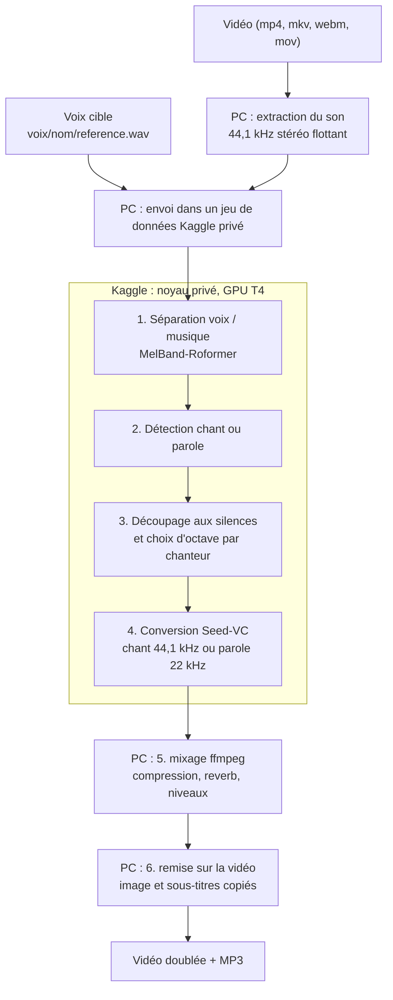

# Voix-là

Voix-là : votre vidéo, avec une autre voix. Et voilà.

> **État : en développement.** Le code (`doubler.py`, `kaggle/`, interface graphique) arrive dans la première
> version, `v0.1.0`. Ce README décrit l'outil tel qu'il fonctionne sur la branche de travail.

`doubler` prend une vidéo (chanson d'une chanteuse ou d'un chanteur, duo, rap, ou vidéo parlée) et rend la même vidéo,
avec son audio, où la voix est remplacée par une voix clonée. La mélodie, le phrasé et l'interprétation restent ceux de
la vidéo. Seul le timbre change : c'est celui de la voix cible.

```sh
doubler --ajouter-voix marie ~/Téléchargements/vocal-marie.ogg   # une fois : enregistrer la voix cible
doubler "Clip.mp4" --voix marie                                  # doubler une vidéo entière
doubler "Clip.mp4" --voix marie --debut 60 --duree 40            # ou un essai de 40 s
```

Le calcul lourd tourne sur un GPU gratuit de Kaggle (T4), piloté depuis le PC par l'API Kaggle. Le PC ne fait que
l'extraction du son, le mixage et la remise sur la vidéo.

## Sommaire

- [Fonctionnement](#fonctionnement)
- [Prérequis](#prérequis)
- [Installation](#installation)
- [Configuration](#configuration)
- [Utilisation](#utilisation)
- [Options](#options)
- [Sorties](#sorties)
- [Ajouter une voix](#ajouter-une-voix)
- [Modes : chant, parole, duo, rap](#modes--chant-parole-duo-rap)
- [Temps de traitement](#temps-de-traitement)
- [Limites connues](#limites-connues)
- [Usage responsable](#usage-responsable)
- [Feuille de route](#feuille-de-route)
- [Développement](#développement)
- [Crédits](#crédits)
- [Licence](#licence)

## Fonctionnement



- **Extraction (PC).** Le son de chaque vidéo est extrait en 44,1 kHz stéréo flottant (les sources dépassent souvent
  0 dBFS). Il part sur Kaggle avec la référence de la voix cible.
- **Séparation (Kaggle).** MelBand-Roformer (via audio-separator) isole la voix. Le reste (musique, bruits) vaut
  exactement l'original moins la voix.
- **Mode (Kaggle).** `chant` s'il y a une musique sous la voix et que la voix chante ou rappe, sinon `parole`.
  Voir [Modes](#modes--chant-parole-duo-rap).
- **Hauteur (Kaggle).** La voix est découpée aux silences en passages de quelques secondes. En chant, chaque
  chanteur reçoit un décalage de −12, 0 ou +12 demi-tons pour rester dans la tonalité de la musique.
- **Conversion (Kaggle).** Seed-VC V1, sans entraînement, à partir de la référence de la voix : modèle chant
  44,1 kHz (avec la hauteur) ou modèle parole 22 kHz. Les passages sont réassemblés à l'échantillon près.
- **Mixage (PC).** Voix convertie filtrée (passe-haut) et compressée, calée sur le niveau moyen de la voix d'origine,
  plus une reverb synthétique en chant, puis limiteur.
- **Remise sur la vidéo (PC).** L'image et les sous-titres sont copiés sans réencodage ; seul le son est réencodé.

Toutes les vidéos d'une même commande partent dans **une seule session Kaggle** : l'installation n'est payée qu'une
fois.

## Prérequis

- **Linux**, avec `ffmpeg` et `ffprobe`.
- **Python 3** en `/usr/bin/python3`, avec **numpy** (utilisé par `--ajouter-voix`).
- **Un compte Kaggle avec le GPU activé.** Kaggle ne donne le GPU et internet aux noyaux qu'après la vérification du
  numéro de téléphone du compte (page *Settings* de Kaggle). Sans elle, le noyau s'arrête sur « ACCÈS REFUSÉ ».
- **La commande Kaggle** dans un environnement Python dédié, à l'emplacement attendu par `doubler` :

  ```sh
  python3 -m venv ~/kaggle-venv
  ~/kaggle-venv/bin/pip install kaggle
  ```

- **Un jeton d'API Kaggle** dans `~/.kaggle/access_token`. Il se crée depuis la page *Settings* de Kaggle, section
  *API*. `doubler` refuse de lancer un doublage si ce fichier manque.

  ```sh
  mkdir -p ~/.kaggle
  # copier le jeton dans ~/.kaggle/access_token, puis :
  chmod 600 ~/.kaggle/access_token
  ```

  Le jeton donne accès à tout votre compte Kaggle. Ne le publiez jamais et ne le mettez jamais dans le dépôt
  (`.gitignore` exclut `access_token` et `kaggle.json`).

Rien d'autre n'est à installer sur le PC : PyTorch, audio-separator, Seed-VC et les poids des modèles sont installés
sur Kaggle.

## Installation

```sh
git clone https://github.com/mawena/Voix-la.git
cd Voix-la
chmod +x doubler.py
mkdir -p ~/.local/bin
ln -s "$PWD/doubler.py" ~/.local/bin/doubler    # la commande doubler, disponible partout
doubler --help
```

`~/.local/bin` doit être dans le `PATH`. Le lien suit le fichier : `doubler` trouve ses dossiers (`voix/`,
`sorties/`, `kaggle/`) à côté de `doubler.py`, même appelé par le lien.

Ensuite, une fois, après la [configuration](#configuration) :

```sh
doubler --preparer-outils
```

Cette commande lance un noyau privé « outils ». Il garde sur Kaggle les paquets pip, Seed-VC à un commit figé et les
poids de tous les modèles. Les doublages suivants le montent au lieu de tout retélécharger, et se replient sur
internet s'il manque ou ne correspond plus. Ce n'est pas obligatoire : sans lui, chaque session télécharge tout.

`doubler` retient que les outils sont prêts dans `<sortie>/.kaggle/outils.json`. Avec un autre dossier de sortie
(`--sortie`), relancez `doubler --preparer-outils --sortie <ce dossier>`.

## Configuration

### Compte Kaggle

Les noms du jeu de données et des noyaux sont écrits en dur en tête de `doubler.py`. Remplacez le compte par le vôtre :

```python
KAGGLE = Path.home() / 'kaggle-venv/bin/kaggle'              # commande Kaggle
JEU    = '<votre-compte>/doublage-voix-entrees'              # jeu de données privé (son des vidéos, référence)
NOYAU  = '<votre-compte>/doublage-voix-gpu'                  # noyau privé de doublage
OUTILS = '<votre-compte>/doublage-outils'                    # noyau privé « outils » (--preparer-outils)
```

`<votre-compte>` est votre nom d'utilisateur Kaggle. Le jeu de données et les noyaux sont créés au premier lancement,
en privé.

### Voix

- Les voix sont des dossiers `voix/<nom>/`, à côté de `doubler.py`. La variable d'environnement `DOUBLER_VOIX` permet
  de les ranger ailleurs.
- La voix par défaut est `marie` (constante `VOIX_DEFAUT` dans `doubler.py`). Le dossier `voix/` n'est pas dans le
  dépôt : après un clonage, ajoutez votre voix, puis passez `--voix <nom>` ou changez `VOIX_DEFAUT`.

## Utilisation

Une vidéo entière :

```sh
doubler "Chanson.mp4" --voix marie
```

Un extrait, pour un essai rapide (secondes) :

```sh
doubler "Episode.mkv" --debut 600 --duree 35
```

L'extrait commence sur l'image clé qui précède `--debut` (l'image n'est pas réencodée) et finit à
`--debut + --duree`. Sans `--duree`, il va jusqu'à la fin ; sans `--debut`, il part du début.

Plusieurs vidéos dans une seule session Kaggle :

```sh
doubler clip1.mp4 clip2.mkv clip3.webm
```

Les mêmes options (`--voix`, `--mode`, `--octave`, `--debut`, `--duree`…) s'appliquent à toutes les vidéos. Une vidéo
en échec n'empêche pas les suivantes.

Refaire seulement le mixage, en quelques secondes, sans Kaggle :

```sh
doubler "Chanson.mp4" --remix --voix-db 6 --reverb-db -10
```

`--remix` repart de `travail/`. Il faut redonner la même vidéo et les mêmes `--voix`, `--debut`, `--duree` et
`--sortie` que pour le doublage, pour retrouver le bon dossier. Seuls `--voix-db` et `--reverb-db` changent le
résultat ; le mode reste celui du doublage.

Imposer l'octave partout (chant), au lieu du choix automatique :

```sh
doubler "Chanson.mp4" --octave -12    # une chanteuse doublée par une voix d'homme
doubler "Chanson.mp4" --octave 0
```

Imposer le mode :

```sh
doubler "Film.mkv" --mode parole      # un dialogue sur une musique très présente
doubler "Chanson.mp4" --mode chant
```

Plus de pas de diffusion (plus fin, plus long sur le GPU) :

```sh
doubler "Chanson.mp4" --pas 50
doubler "Chanson.mp4" --comparer-pas 50   # écouter 30 pas contre 50 pas sur ~30 s
```

Choisir la voix cible, lister les voix :

```sh
doubler "Chanson.mp4" --voix marie
doubler --voix-liste
```

Pendant le traitement, `doubler` affiche les étapes Kaggle, puis le mode retenu et la frise des passages (voix,
hauteur médiane, décalage en demi-tons).

Un seul doublage tourne à la fois par dossier de sortie : une deuxième commande attend que la première ait fini avec
Kaggle. Si toutes les sessions GPU du compte sont prises, `doubler` attend aussi une place.

## Options

| Option | Rôle | Défaut |
|---|---|---|
| `videos…` | une ou plusieurs vidéos (mp4, m4v, mov, mkv, webm…) | |
| `--voix NOM` | voix cible, un dossier de `voix/` | `marie` |
| `--mode auto\|chant\|parole` | `auto` : chant s'il y a une musique sous la voix et que la voix chante ou rappe, sinon parole | `auto` |
| `--octave auto\|0\|-12\|+12` | `auto` : décidé passage par passage ; sinon décalage imposé partout (`12` vaut `+12`). Sans effet en parole avec le modèle 22 kHz | `auto` |
| `--pas N` | pas de diffusion Seed-VC ; 50 donne plus de finesse pour environ 40 % de GPU en plus | `30` |
| `--voix-db N` | niveau de la voix convertie par rapport à la voix d'origine (dB) | `+4` en chant, `0` en parole |
| `--reverb-db N` | niveau de la reverb sous la voix sèche (dB), en chant seulement | `-13` |
| `--debut S` | début de l'extrait (s), calé sur l'image clé qui précède | début de la vidéo |
| `--duree S` | durée de l'extrait (s) | jusqu'à la fin |
| `--remix` | refaire seulement le mixage et la vidéo depuis `travail/`, sans Kaggle | |
| `--sortie DIR` | dossier des sorties | `sorties/` à côté de `doubler.py` |
| `--comparer-pas N` | convertir aussi les ~30 s les plus chantées en N pas, pour comparer | |
| `--ajouter-voix NOM ENREGISTREMENT` | ajouter une voix depuis un enregistrement (audio ou vidéo) | |
| `--voix-liste` | afficher les voix disponibles | |
| `--preparer-outils` | une fois : préparer sur Kaggle les paquets et les modèles | |

Deux options de mise au point existent mais n'apparaissent pas dans `--help` : `--modele-parole parole22k|chant44k`
(modèle utilisé en parole) et `--comparer-modeles` (en parole, convertir aussi avec l'autre modèle).

## Sorties

Tout va dans `sorties/<titre>/` (ou le dossier de `--sortie`). Un extrait va dans `sorties/<titre> (extrait …)/`,
par exemple `Clip (extrait 1m00,0+0m40,0)/`.

| Fichier | Contenu |
|---|---|
| `<titre> - voix <Nom>.<ext>` | la vidéo doublée, dans le conteneur d'origine (mkv si l'extension n'est pas connue) |
| `<titre> - voix <Nom>.mp3` | le son doublé, MP3 320 kb/s |
| `comparaison_<pas>pas.mp3`, `comparaison_<N>pas.mp3` | avec `--comparer-pas` : le même passage dans les deux réglages |
| `travail/` | `original.wav` (son extrait), `voix_source.wav` (voix isolée), `instrumental.wav` (le reste), `source.json` |
| `travail/<voix>/` | `voix_convertie.flac`, `mix.wav`, `rapport.json`, journal Kaggle, fichiers intermédiaires du mixage |

Dans la vidéo doublée :

- l'image est copiée telle quelle, sans réencodage ;
- le son est en AAC 256 kb/s (Opus 192 kb/s en webm), en stéréo ;
- les sous-titres sont copiés si le conteneur les accepte (mov_text en mp4 et mov, texte et images en mkv, WebVTT en
  webm), sinon laissés de côté avec un message. En mkv, les polices jointes sont copiées aussi.

`rapport.json` donne le mode et ses mesures, la hauteur et le décalage de chaque passage, la ressemblance de timbre
mesurée, et la durée de chaque étape (champ `temps_local` pour la session entière).

`travail/` est volumineux : les fichiers y sont en WAV 32 bits flottant, soit plusieurs centaines de Mo pour une
chanson entière. Il sert à `--remix` ; on peut l'effacer quand le résultat convient.

## Ajouter une voix

```sh
doubler --ajouter-voix marie ~/Téléchargements/vocal-marie.ogg   # n'importe quel audio ou vidéo, même un vocal de messagerie
doubler --voix-liste
doubler "Clip.mp4" --voix marie
```

Le nom ne contient que des minuscules, des chiffres, `-` ou `_`. Une voix est un dossier `voix/<nom>/` qui contient :

- `reference.wav` : au plus 25 s de parole (20 à 25 s si l'enregistrement est assez long), mono, 44,1 kHz,
  à −26 LUFS ;
- `voix.json` : nom affiché (modifiable), hauteur de parole médiane, origine, date, alertes.

L'enregistrement est nettoyé sur le PC, en quelques secondes :

- mono, passe-haut à 70 Hz ;
- silences du début et de la fin coupés, longues pauses raccourcies ;
- choix du meilleur extrait continu de 20 à 25 s, puis sonie ramenée à −26 LUFS (moins si les crêtes saturaient) ;
- mesure de la hauteur de parole (YIN, avec correction des sauts d'octave).

Une alerte s'affiche si l'enregistrement a moins de 15 s de parole, s'il est bruité (parole à moins de 25 dB au-dessus
du fond) ou s'il est saturé. La référence est envoyée dans le jeu de données Kaggle privé à chaque session qui
utilise cette voix.

### Bien enregistrer

Pour la parole (c'est ce que `--ajouter-voix` attend) :

- 30 à 60 s de parole naturelle, d'une seule personne ;
- une pièce calme et sans écho (une pièce meublée vaut mieux qu'une salle de bains) ;
- le téléphone ou le micro à environ 20 cm de la bouche ;
- ni musique, ni télé, ni autre voix derrière ;
- une voix posée, à un niveau qui ne sature pas.

Pour le chant :

- la référence actuelle est de la parole : elle donne le timbre, la mélodie vient de la vidéo ;
- si vous enregistrez du chant pour une future version, chantez a cappella, sans musique dans le casque qui
  déborderait dans le micro ;
- gardez la même distance au micro sur les notes fortes, et baissez le niveau d'enregistrement plutôt que de saturer ;
- variez les hauteurs et les voyelles tenues, dans votre tessiture confortable.

N'enregistrez que votre voix, ou celle d'une personne d'accord pour être clonée (voir
[Usage responsable](#usage-responsable)).

## Modes : chant, parole, duo, rap

Le mode est choisi pour chaque vidéo à partir de deux mesures :

- **musique sous la voix** : le reste (hors voix) est assez fort et tonal (des notes tenues), ou fort et presque
  continu ;
- **voix chantée** : une part suffisante de notes tenues, ou une voix presque continue (rap).

Les deux ensemble donnent `chant`, sinon `parole`. Un dialogue sur une musique de film reste donc de la parole.

### Chant

- Modèle Seed-VC 44,1 kHz guidé par la hauteur (RMVPE).
- Décalage de −12, 0 ou +12 demi-tons seulement, pour rester dans la tonalité de la musique.
- Chaque voix cible a un **centre de chant**, estimé à deux fois sa hauteur de parole médiane.
- Le genre de chaque passage est estimé par son empreinte vocale CAMPPlus, comparée à deux ancres
  (`kaggle/ancres_genre.json` : empreintes moyennes d'une voix d'homme et d'une voix de femme chantées, sans aucun son).
  La hauteur seule ne suffit pas : dans un duo, un chanteur peut chanter aussi haut que sa partenaire.
- Une voix d'homme a un centre de chant de 250 Hz, une voix de femme de 420 Hz. On garde l'octave qui rapproche ce
  centre de celui de la voix cible. Pour une voix cible d'homme (parole vers 100 Hz), cela donne 0 pour un chanteur et
  −12 pour une chanteuse ; pour une voix cible de femme (parole vers 200 Hz), +12 pour un chanteur et 0 pour une
  chanteuse.
- Le mixage ajoute une reverb synthétique de 1,6 s sous la voix (`--reverb-db`), et la voix passe à +4 dB au-dessus
  de la voix d'origine (`--voix-db`).

### Voix seule et duo

- **Voix seule** (un seul genre sur au moins 85 % du chant) : la même décision tout du long. Seule exception, un
  passage qui serait à plus d'une octave de la voix cible avec ce décalage.
- **Duo** : décision passage par passage selon le genre. Un passage ambigu (chant à deux, empreinte entre les deux)
  garde la décision précédente. Un passage isolé et peu marqué, entre deux voisins d'accord, les suit.

### Rap

Le rap passe en mode `chant` quand il y a une musique dessous : la voix est presque continue, même sans notes
tenues. Le choix d'octave et le mixage sont ceux du chant.

### Parole

- Modèle Seed-VC 22 kHz prévu pour la parole. La voix rejoint d'elle-même la hauteur de parole de la voix cible ;
  `--octave` n'a pas d'effet.
- Pas de reverb ; le fond sonore est gardé, et la voix est au niveau de la voix d'origine (`--voix-db 0`).

## Temps de traitement

Temps mesurés de bout en bout, à 30 pas, avec les outils préparés (`--preparer-outils`), une vidéo par session :

| Vidéo | Durée | Temps total |
|---|---|---|
| extrait demandé de 40 s (45 s après calage sur l'image clé) | 0 min 45 | environ 5 min |
| chanson entière | 3 min 45 | environ 12 à 13 min |
| chanson entière | 5 min 35 | environ 17 min |

- Environ 3 min sont fixes à chaque session : envoi du son, démarrage du noyau, installation, chargement des modèles,
  rapatriement. Doubler plusieurs vidéos dans une même commande ne les paie qu'une fois.
- Ensuite, sur le GPU T4, la séparation prend environ 0,7 fois la durée du son, et la conversion environ 1,3 à 1,5 fois
  à 30 pas.
- Le mixage et la remise sur la vidéo prennent quelques secondes à une demi-minute sur le PC.
- S'y ajoute l'attente d'une place GPU sur Kaggle, de zéro à quelques minutes.

## Limites connues

- **Plusieurs voix en même temps** (harmonies, chœurs, duo à l'unisson) : la voix isolée les contient toutes, et la
  conversion n'en fait qu'une, d'où des artefacts sur ces passages. Leur octave suit le passage précédent.
- **Choix d'octave** : le genre est estimé à partir de deux ancres seulement. Une voix atypique (homme au timbre très
  clair, contre-ténor, voix d'enfant) peut être mal classée. Une voix d'homme seule peut ainsi partir à −12, avec des
  sauts à 0 en pleine chanson. `--octave` impose alors le décalage.
- **Notes très graves** : après la descente d'une octave, les notes les plus graves de la source peuvent sonner
  creuses.
- **Mode** : un dialogue continu sur une musique de film très présente peut être pris pour du chant ; `--mode parole`
  le corrige.
- **Extraits** : un extrait commence sur l'image clé qui précède `--debut`, donc souvent un peu plus tôt.
- **Son** : la sortie est en stéréo, même si la vidéo était en 5.1.
- **Kaggle** : il faut une connexion internet stable et le quota GPU gratuit du compte. Chaque appel à Kaggle a une
  limite de temps (2 min pour un état, 30 min pour un envoi) : une coupure réseau ne bloque pas `doubler` indéfiniment.

## Usage responsable

- **Ne clonez que votre propre voix, ou une voix dont la personne vous a donné son accord.** Le fichier `voix.json`
  de chaque voix porte un rappel de consentement.
- **Usage personnel.** Voix-là sert à s'amuser, à s'entraîner et à tester sa voix sur des chansons.
- **Les chansons et les vidéos restent la propriété de leurs auteurs.** Ne diffusez pas un doublage sans en avoir les
  droits.
- **Vos données restent chez vous et sur votre compte Kaggle privé.** Seuls le son des vidéos, la référence de la
  voix choisie, le script du noyau et ses réglages partent, dans un jeu de données et un noyau privés. Rien n'est
  envoyé ailleurs. Le noyau télécharge ses outils (paquets pip, Seed-VC sur GitHub, poids sur Hugging Face) mais
  n'y envoie rien.
- Les versions du jeu de données et les sorties des noyaux restent sur votre compte Kaggle jusqu'à ce que vous les
  supprimiez.
- Les enregistrements de voix (`voix/`), les vidéos (`Vidéos/`) et les sorties (`sorties/`) sont exclus du dépôt.

## Feuille de route

À venir :

- [ ] banc d'essai de la qualité, sur quelques extraits de référence, avec un même mixage pour toutes les versions ;
- [ ] voix nettoyée avant conversion : voix principale séparée des chœurs, reverb d'origine retirée ;
- [ ] modèle Seed-VC affiné sur les enregistrements de la voix cible, gardé sur Kaggle pour être réutilisé ;
- [ ] mixage v2 : suivre les nuances de la voix d'origine, adoucir les « s » ;
- [ ] envoi du son en FLAC plutôt qu'en WAV, pour gagner du temps à chaque session ;
- [ ] correction du choix d'octave : la hauteur d'abord, un seul décalage par chanteur.

## Développement

### Branches et versions

Le dépôt suit **git flow** :

- `main` : versions stables ;
- `develop` : intégration ;
- `feature/*` : nouvelles fonctions, à partir de `develop` ;
- `release/*` : préparation d'une version ;
- `hotfix/*` : corrections urgentes, à partir de `main` ;
- tags `vX.Y.Z` sur `main`.

Les messages de commit suivent les [commits conventionnels](https://www.conventionalcommits.org/fr/), en français :

```text
feat: choix d'octave par chanteur
fix: délai maximal sur les appels Kaggle
docs: README complet
```

### Structure du dépôt

```text
.
├── doubler.py               commande doubler : extraction, envoi et suivi Kaggle, mixage, remise sur la vidéo, voix
├── kaggle/
│   ├── doubler_kaggle.py    noyau GPU : séparation, mode, hauteur, conversion Seed-VC ; noyau « outils »
│   └── ancres_genre.json    empreintes moyennes d'une voix d'homme et d'une voix de femme chantées (aucun son)
├── README.md
├── LICENSE
└── .gitignore
```

`doubler.py` envoie `kaggle/doubler_kaggle.py` comme noyau Kaggle, avec ses réglages intégrés au script.

Dossiers et fichiers locaux, exclus par `.gitignore` :

| Exclu | Pourquoi |
|---|---|
| `voix/` | enregistrements et fiches de voix : données personnelles |
| `Vidéos/` | vidéos sources : œuvres protégées |
| `sorties/` | doublages et fichiers de travail, lourds et protégés |
| `*.wav`, `*.flac`, `*.mp3`, `*.mp4`, `*.mkv`, `*.webm`, `retour*/` | sons, vidéos et retours de Kaggle, où qu'ils soient |
| `access_token`, `kaggle.json` | jeton d'API Kaggle : jamais dans le dépôt |
| `__pycache__/` | cache Python |

## Crédits

Voix-là assemble des outils libres, téléchargés sur Kaggle à l'exécution. Aucun de leurs codes ni de leurs poids n'est
inclus dans ce dépôt ; chacun garde sa propre licence.

| Outil | Rôle ici | Licence |
|---|---|---|
| [Seed-VC](https://github.com/Plachtaa/seed-vc) (Plachtaa) | conversion de voix sans entraînement, V1, commit figé | GPL-3.0 |
| [audio-separator](https://github.com/nomadkaraoke/python-audio-separator) | séparation voix / musique (version 0.48.0) | MIT |
| [MelBand-Roformer](https://huggingface.co/KimberleyJSN/melbandroformer) (Kimberley Jensen) | modèle de séparation `vocals_mel_band_roformer.ckpt` | voir la page du modèle |
| RMVPE | hauteur de la voix (fourni avec Seed-VC) | voir le dépôt de Seed-VC |
| CAMPPlus (3D-Speaker) | empreinte vocale : timbre de la référence, genre des passages, locuteurs (fourni avec Seed-VC) | voir le dépôt de Seed-VC |
| Whisper (OpenAI), BigVGAN (NVIDIA) | encodeur et vocodeur utilisés par Seed-VC | voir le dépôt de Seed-VC |
| [Kaggle](https://www.kaggle.com) | GPU T4 gratuit, jeux de données et noyaux privés | conditions d'utilisation de Kaggle |
| [FFmpeg](https://ffmpeg.org) | extraction, mixage, encodage, remise sur la vidéo | LGPL / GPL |

## Licence

Code sous licence MIT : voir [LICENSE](LICENSE). Copyright (c) 2026 mawena.

Cette licence couvre le code de ce dépôt seulement. Les outils et modèles cités dans les [crédits](#crédits) gardent
la leur, et les œuvres doublées restent la propriété de leurs auteurs.
